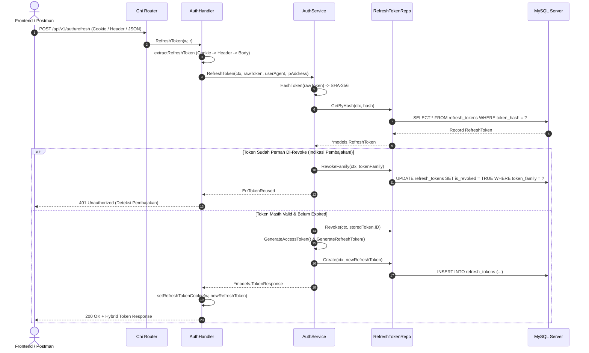
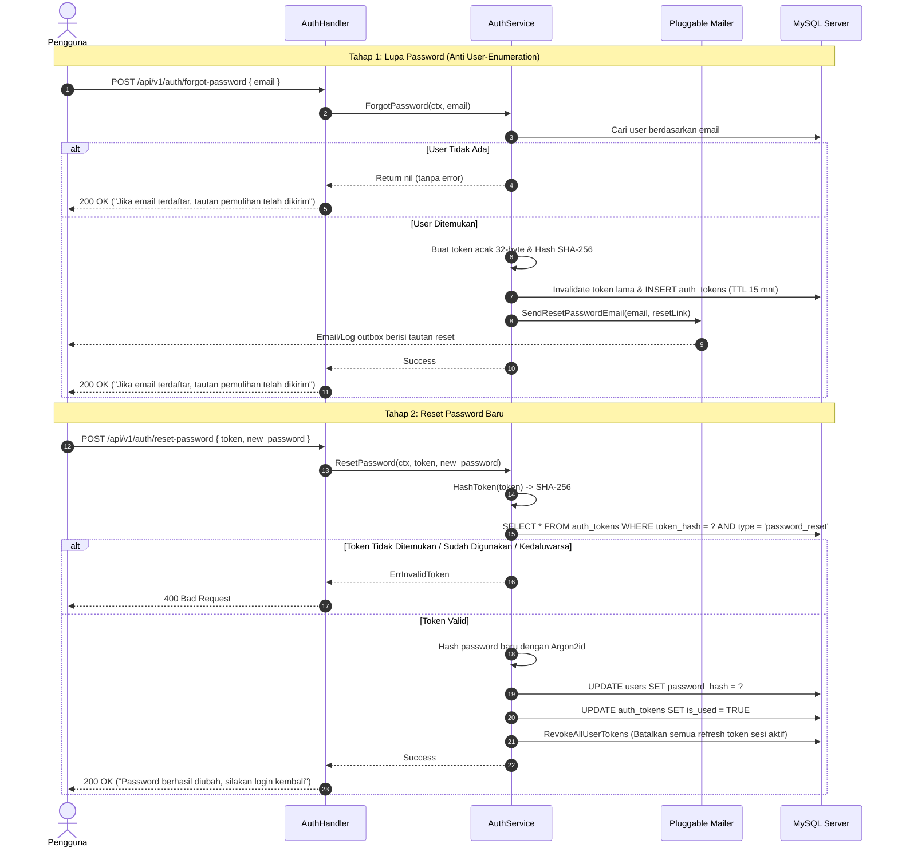

# Panduan Lengkap Memahami Proyek (Golang Learning Guide)

Dokumen ini disusun sebagai **panduan belajar komprehensif** untuk memahami arsitektur, pola desain (_design pattern_), alur eksekusi, serta idiom bahasa Go yang diimplementasikan pada **Go REST API Starter Kit (`go-crud-api`)**.

---

## 1. Peta Konsep Utama Golang pada Proyek Ini

| Konsep Golang                 | Lokasi Penerapan                                                                                     | Penjelasan Singkat                                                                                                                                                                                                                   |
| :---------------------------- | :--------------------------------------------------------------------------------------------------- | :----------------------------------------------------------------------------------------------------------------------------------------------------------------------------------------------------------------------------------- |
| **Identitas ULID**            | `internal/utils/ulid.go`                                                                             | Crockford Base32 26-karakter (`github.com/oklog/ulid/v2`) menggantikan integer auto-increment, mencegah scraping ID, dan otomatis terurut kronologis.                                                                                |
| **JWT & Refresh Token**       | `internal/utils/jwt.go`, `internal/service/auth_service.go`                                          | Access Token stateless HS256 (`golang-jwt/jwt/v5`) dan Refresh Token acak 64-karakter dengan hashing SHA-256 serta Refresh Token Rotation (RTR).                                                                                     |
| **Pluggable Adapter Pattern** | `internal/mailer/`                                                                                   | Abstraksi interface `Mailer` dengan dua driver konkret: `LogMailer` (100% lokal di terminal) dan `ResendMailer` (production via REST API Resend).                                                                                    |
| **One-Time Token & Hashing**  | `internal/models/auth_token.go`, `internal/repository/auth_token_repository.go`                      | Token acak 32-byte untuk pemulihan akun & verifikasi email. Token mentah hanya dikirimkan sekali ke email, sedangkan database hanya menyimpan hash **SHA-256**.                                                                      |
| **Struct, Pointer & DTO**     | `internal/models/`                                                                                   | Memisahkan entitas domain (`User`, `UserProfile`, `RefreshToken`, `AuthToken`, `Post`) dari DTO input (`RegisterInput`, `ResetPasswordInput`, `UpdateProfileInput`). Pointer dipakai untuk field nullable (`*string`, `*time.Time`). |
| **Interface & DIP**           | `internal/service/`, `internal/repository/`, `internal/mailer/`                                      | Layer atas bergantung pada **interface** (`UserRepository`, `AuthTokenRepository`, `Mailer`, `AuthServiceInterface`) agar modular dan mudah di-mock.                                                                                 |
| **Type-Safe SQL (`sqlc`)**    | `db/queries/`, `internal/repository/sqlc/`                                                           | Query SQL dikompilasi oleh `sqlc` menjadi fungsi Go yang strongly-typed tanpa overhead ORM.                                                                                                                                          |
| **Embedded Assets (`embed`)** | `db/embed.go`                                                                                        | File migrasi SQL di-embed ke dalam binary Go dengan `//go:embed migrations/*.sql`.                                                                                                                                                   |
| **Goroutines & Channels**     | `cmd/server/main.go`                                                                                 | Menjalankan HTTP server, pembersihan background token kedaluwarsa (`time.Ticker`), serta menangkap sinyal shutdown OS (`os.Signal`).                                                                                                 |
| **Error Handling & Sentinel** | `internal/repository/`, `internal/service/`                                                          | Sentinel errors (`ErrNotFound`, `ErrDuplicate`, `ErrTokenReused`, `ErrInvalidCredentials`) dipetakan lewat `errors.Is` dan `errors.As`.                                                                                              |
| **Higher-Order Functions**    | `internal/middleware/auth.go`, `internal/routes/routes.go`                                           | Middleware standar `net/http` (`func(http.Handler) http.Handler`) di router **Chi**.                                                                                                                                                 |
| **Context & Timeouts**        | `cmd/server/main.go`, `internal/middleware/auth.go`                                                  | `context.WithTimeout` untuk graceful shutdown, `context.WithCancel` untuk stop worker, dan `context.WithValue` untuk menyisipkan `user_id`, `role`, dan claims JWT.                                                                  |
| **Testing & Mocking**         | `internal/handlers/handlers_test.go`, `internal/service/*_test.go`, `internal/mailer/mailer_test.go` | Table-driven tests, in-memory repository mocks, dan `net/http/httptest` tanpa database nyata.                                                                                                                                        |

---

## 2. Struktur Proyek & Filosofi Desain

Aplikasi ini menerapkan **Layered Architecture** (`Handler → Service → Repository → Database`) berbasis _Standard Go Project Layout_:

```text
go-crud-api/
├── cmd/
│   └── server/
│       └── main.go                     # [1] Composition Root, Bootstrap server & Token cleanup
├── db/
│   ├── embed.go                        # [2] Embed file SQL migrasi ke runtime binary
│   ├── migrations/                     # [3] Skema DDL golang-migrate dengan ULID (.up.sql / .down.sql)
│   └── queries/                        # [4] Sumber query SQL untuk generator sqlc
│       ├── auth_tokens.sql             # Query untuk token verifikasi & reset
│       ├── categories.sql
│       ├── post_views.sql
│       ├── posts.sql
│       ├── refresh_tokens.sql
│       ├── user_profiles.sql
│       └── users.sql
├── docs/
│   ├── ref/
│   │   └── architecture_reference.md   # [5] Blueprint arsitektur backend untuk proyek baru
│   ├── learning_guide.md               # [6] Panduan belajar proyek (file ini)
│   ├── starter_kit_specification.md    # [7] Spesifikasi teknis, skema DB, & kontrak endpoint
│   ├── technical_specification.md      # [8] Spesifikasi teknis modul & database schema
│   └── postman_collection.json         # [9] Koleksi Postman v2.1 siap pakai
├── internal/                           # [10] Kode privat modul (tidak bisa diimpor modul luar)
│   ├── config/                         # Konfigurasi environment (.env / OS env)
│   ├── database/                       # Connection pool, migrate runner (-fresh), & seeder ULID
│   ├── handlers/                       # HTTP Handlers (Auth, User, Admin, Public) + httptest
│   ├── mailer/                         # Pluggable Mailer (LogMailer & ResendMailer)
│   ├── middleware/                     # JWT Auth, RequireRole, & CORS middleware
│   ├── models/                         # Domain Entities, Input DTOs, & payload validators
│   ├── repository/                     # Repository interfaces, wrapper sqlc, & dynamic SQL
│   ├── routes/                         # Chi Router, sub-routes, uploads, & rate limiter
│   ├── service/                        # Business logic, Argon2id, RTR, Mailer orchestration
│   └── utils/                          # ULID, JWT, HashToken, response helpers
├── .air.toml                           # Live-reload config (Air)
├── .env.example                        # Template environment variables
├── api.http                            # Koleksi request untuk VS Code REST Client
├── go.mod / go.sum                     # Manifest dependensi Go
└── sqlc.yaml                           # Konfigurasi generator sqlc
```

---

## 3. Bedah Komponen Lapisan demi Lapisan

### A. Lapisan Model (`internal/models/`)

1. **`auth.go`**:
   - `TokenResponse`: memuat DTO hybrid (`access_token`, `refresh_token`, `token_type`, `expires_in`).
   - `RegisterInput` & `LoginInput`: DTO request dengan validasi regex username dan email.
   - `RefreshToken`: representasi entity token sesi di database.
2. **`auth_token.go`**:
   - `AuthToken`: representasi entity token sementara di MySQL (`password_reset`, `email_verification`, `email_change`).
   - DTOs: `ForgotPasswordInput`, `ResetPasswordInput`, `VerifyEmailInput`, `ResendVerificationInput`, `RequestEmailChangeInput`, `ConfirmEmailChangeInput`.
   - Metode `Validate()` untuk masing-masing DTO dengan validasi format email, kekuatan kata sandi, dan format token.
3. **`user.go`**:
   - `User`: kredensial akun dengan tag `json:"-"` pada `PasswordHash`.
   - `UserProfile`: data profil personal (`FullName`, `Bio`, `PhoneNumber`, `AvatarURL`).
   - `UserWithProfile`: model agregasi JOIN untuk endpoint `/api/v1/users/me`.
4. **`post.go` & `category.go`**:
   - Entitas modul konten dengan ID string 26-karakter (ULID).

### B. Lapisan Repository (`internal/repository/`)

1. **Interface & Sentinel Errors**:
   - `UserRepository`, `UserProfileRepository`, `RefreshTokenRepository`, `AuthTokenRepository`, `CategoryRepository`, `PostRepository`.
   - Sentinel error: `ErrNotFound` dan `ErrDuplicate` (mendeteksi error MySQL 1062 via `IsDuplicateKeyError`).
2. **Penugasan ULID**:
   - Setiap method `Create()` mengecek apakah ID kosong; jika ya, memanggil `utils.NewULID()` sebelum query `INSERT` dieksekusi.
3. **One-Time Token Storage (`AuthTokenRepository`)**:
   - Menyimpan hash SHA-256 (`CHAR(64)`), status `is_used`, dan `expires_at`.
   - Metode `InvalidateTokensByType` untuk membatalkan token lama saat token baru diterbitkan (misal: saat resend verification).
   - Metode `DeleteExpiredOrUsedTokens` yang dieksekusi secara berkala oleh background worker.

### C. Subsistem Mailer Pluggable (`internal/mailer/`)

Menerapkan **Adapter / Strategy Pattern** melalui interface `Mailer`:

```go
type Mailer interface {
    SendResetPasswordEmail(ctx context.Context, toEmail, resetLink string) error
    SendVerificationEmail(ctx context.Context, toEmail, verifyLink string) error
    SendEmailChangeEmail(ctx context.Context, toNewEmail, confirmLink string) error
}
```

1. **`LogMailer` (Default Development)**:
   - Aktif jika `MAILER_DRIVER=log`.
   - Mencetak email outbox dalam format kotak ASCII yang cantik di terminal log tanpa perlu akun/koneksi eksternal.
2. **`ResendMailer` (Production Ready)**:
   - Aktif jika `MAILER_DRIVER=resend`.
   - Mengirim email HTML responsif melalui REST API resmi Resend menggunakan standard library `net/http`.

### D. Lapisan Service (`internal/service/`)

1. **`auth_service.go` (`AuthServiceInterface`)**:
   - **Register**: Validasi duplikasi email & username, hashing password dengan **Argon2id**, buat record user dan profil default, serta terbitkan token verifikasi email otomatis.
   - **Login**: Verifikasi kredensial Argon2id, periksa status akun (`active`), terbitkan JWT Access Token dan Refresh Token, simpan hash SHA-256 token baru ke database.
   - **RefreshToken (RTR)**: Deteksi pembajakan (_Reuse Detection_). Jika token yang dikirim statusnya sudah `is_revoked`, seluruh keluarga token (`token_family`) langsung dicabut. Jika valid, token lama di-revoke dan token baru diterbitkan.
   - **ForgotPassword**: Menerapkan proteksi ketat anti _user-enumeration_ (selalu merespons `200 OK`). Membuat token acak 32-byte (64 hex), menyimpan hash SHA-256 (TTL 15 menit), dan mengirim tautan reset via Mailer.
   - **ResetPassword**: Memvalidasi token & waktu kedaluwarsa, memastikan belum digunakan, meng-hash password baru dengan Argon2id, menandai token `is_used = TRUE`, dan mencabut seluruh sesi refresh token aktif pengguna (_forced logout_).
   - **VerifyEmail & ResendVerification**: Memvalidasi token verifikasi dan memperbarui `email_verified_at = NOW()`.
   - **Logout & ChangePassword**: Mencabut sesi token dan membatalkan refresh token di DB.
2. **`user_service.go` (`UserServiceInterface`)**:
   - **RequestEmailChange**: Memvalidasi password saat ini, memastikan email baru belum terdaftar, menyimpan email tujuan di `payload` token (TTL 1 jam), dan mengirim email verifikasi ke email baru.
   - **ConfirmEmailChange**: Memvalidasi token, mengupdate `users.email = payload`, dan menandai email sebagai terverifikasi.
   - Menangani update profil personal, upload/delete avatar, dan perubahan username.

### E. Lapisan Middleware & Routing (`internal/middleware/`, `internal/routes/`)

1. **`middleware/auth.go`**:
   - `JWTAuthMiddleware`: Membaca header `Authorization: Bearer <token>`, memvalidasi signature & expiry, lalu menyuntikkan claims ke context.
   - `RequireRole`: Memastikan user memiliki role tertentu (misalnya `admin`).
2. **`routes/routes.go`**:
   - `/api/v1/auth/*`: Registrasi, login, forgot-password, dan resend-verification diproteksi rate limiter `httprate.LimitBy` (10 req/menit per IP).
   - `/api/v1/auth/verify-email`: Menerima token via URL query parameter (`?token=...`) maupun JSON payload body.
   - `/api/v1/users/email/confirm-change`: Dapat diakses publik melalui browser tanpa header Authorization Bearer.
   - `/api/v1/users/*`: Seluruh endpoint user lainnya diproteksi `JWTAuthMiddleware`.
   - `/api/v1/admin/*`: Diproteksi `JWTAuthMiddleware` + `RequireRole("admin")`.

---

## 4. Alur Request Nyata (Lifecycle Walkthrough)

### Skenario 1: User Melakukan Refresh Token Rotation (`POST /api/v1/auth/refresh`)



### Skenario 2: Alur Pemulihan Password Aman (Forgot & Reset Password)



---

## 5. Menjalankan Seluruh Pengujian

Jalankan seluruh unit test dan handler integration test:

```powershell
go test -v ./...
```
