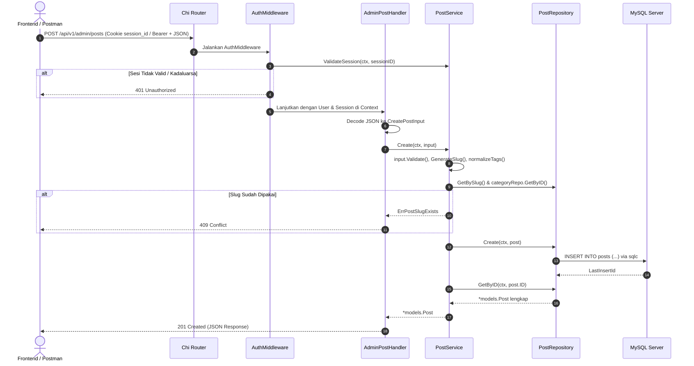

# Panduan Lengkap Memahami Proyek (Golang Learning Guide)

Dokumen ini disusun sebagai **panduan belajar komprehensif** untuk memahami arsitektur, pola desain (_design pattern_), alur eksekusi, serta idiom bahasa Go yang diimplementasikan pada proyek **mmdbconnect CMS (`go-crud-api`)**.

---

## 1. Peta Konsep Utama Golang pada Proyek Ini

| Konsep Golang                 | Lokasi Penerapan                                                                                  | Penjelasan Singkat                                                                                                                                                                             |
| ----------------------------- | ------------------------------------------------------------------------------------------------- | ---------------------------------------------------------------------------------------------------------------------------------------------------------------------------------------------- |
| **Struct, Pointer & DTO**     | `internal/models/`                                                                                | Memisahkan entitas domain (`Post`, `User`, `Category`, `Session`) dari DTO input (`CreatePostInput`, `LoginInput`). Pointer dipakai untuk field nullable (`*string`, `*uint64`, `*time.Time`). |
| **Interface & DIP**           | `internal/service/`, `internal/repository/`, `internal/middleware/`                               | Setiap layer atas bergantung pada **interface** (`PostRepository`, `PostServiceInterface`, `MarkdownRenderer`, `SessionValidator`) agar modular dan mudah di-mock.                             |
| **Type-Safe SQL (`sqlc`)**    | `db/queries/`, `internal/repository/sqlc/`                                                        | Query SQL dikompilasi oleh `sqlc` menjadi fungsi Go yang strongly-typed tanpa overhead ORM.                                                                                                    |
| **Embedded Assets (`embed`)** | `db/embed.go`                                                                                     | File migrasi SQL di-embed ke dalam binary Go dengan `//go:embed migrations/*.sql`.                                                                                                             |
| **Goroutines & Channels**     | `cmd/server/main.go`                                                                              | Menjalankan HTTP server, background session cleanup (`time.Ticker`), serta menangkap sinyal shutdown OS (`os.Signal`).                                                                         |
| **Error Handling & Sentinel** | `internal/repository/`, `internal/service/`                                                       | Sentinel errors (`ErrNotFound`, `ErrDuplicate`, `ErrPostSlugExists`, `ErrInvalidCredentials`) dipetakan lewat `errors.Is` dan `errors.As`.                                                     |
| **Higher-Order Functions**    | `internal/middleware/auth.go`, `internal/routes/routes.go`                                        | Middleware standar `net/http` (`func(http.Handler) http.Handler`) di router **Chi**.                                                                                                           |
| **Context & Timeouts**        | `cmd/server/main.go`, `internal/middleware/auth.go`                                               | `context.WithTimeout` untuk graceful shutdown, `context.WithCancel` untuk stop worker, dan `context.WithValue` untuk menyisipkan user & session aktif.                                         |
| **Testing & Mocking**         | `internal/handlers/handlers_test.go`, `internal/service/*_test.go`, `internal/utils/slug_test.go` | Table-driven tests, in-memory repository mocks, dan `net/http/httptest` tanpa database nyata.                                                                                                  |

---

## 2. Struktur Proyek & Filosofi Desain

Aplikasi ini menerapkan **Layered Architecture** (`Handler → Service → Repository → Database`) berbasis _Standard Go Project Layout_:

```text
go-crud-api/
├── cmd/
│   └── server/
│       └── main.go                     # [1] Composition Root & Bootstrap server
├── db/
│   ├── embed.go                        # [2] Embed file SQL migrasi ke runtime binary
│   ├── migrations/                     # [3] Skema DDL golang-migrate (.up.sql / .down.sql)
│   └── queries/                        # [4] Sumber query SQL untuk generator sqlc
├── docs/
│   ├── ref/
│   │   └── architecture_reference.md   # [5] Blueprint arsitektur backend untuk proyek baru
│   ├── learning_guide.md               # [6] Panduan belajar proyek (file ini)
│   ├── technical_specification.md      # [7] Spesifikasi teknis, skema DB, & kontrak endpoint
│   └── postman_collection.json         # [8] Koleksi Postman v2.1 siap pakai
├── internal/                           # [9] Kode privat modul (tidak bisa diimpor modul luar)
│   ├── config/                         # Konfigurasi environment (.env / OS env)
│   ├── database/                       # Connection pool, migrate runner, & initial seeder
│   ├── handlers/                       # HTTP Delivery Layer (Admin & Public) + httptest
│   ├── middleware/                     # HTTP-only Cookie Auth & CORS middleware
│   ├── models/                         # Domain Entities, Input DTOs, & filter validators
│   ├── repository/                     # Repository interfaces, wrapper sqlc, & dynamic SQL
│   ├── routes/                         # Chi Router, aliases, static uploads, & rate limiter
│   ├── service/                        # Business logic, Argon2id, Goldmark MarkdownRenderer
│   └── utils/                          # Slug generator, pagination, & JSON response helpers
├── .air.toml                           # Live-reload config (Air)
├── .env.example                        # Template environment variables
├── api.http                            # Koleksi request untuk VS Code REST Client
├── go.mod / go.sum                     # Manifest dependensi Go
└── sqlc.yaml                           # Konfigurasi generator sqlc
```

### Mengapa menggunakan folder `internal/`?

Di Go, compiler menegakkan visibilitas folder `internal/`: package di dalamnya **hanya boleh diimpor oleh modul `github.com/mochammadbagas/go-crud-api`**, sehingga detail implementasi tidak bocor keluar.

---

## 3. Bedah Komponen Lapisan demi Lapisan

### A. Lapisan Model (`internal/models/`)

1. **`post.go`**:
   - Entitas `Post`, konstanta `TypeBlog`/`TypeArticle`/`TypeJournal` dan `StatusDraft`/`StatusPublished`.
   - `ComputeSEOMetadata()`: menerapkan fallback SEO (`meta_title` → `title`, `meta_description` → `excerpt`).
   - `CreatePostInput.Validate()` & `UpdatePostInput.Validate()`: validasi input payload.
   - `ValidateType()` & `ValidateStatus()`: validator terpusat untuk query parameter di handler.
2. **`user.go`**, **`category.go`**, **`session.go`**:
   - Tag `json:"-"` pada `User.PasswordHash` memastikan hash Argon2id tidak pernah keluar ke JSON response, ditambah projection `UserProfile`.
   - `Session.IsExpired()` mengecek masa berlaku sesi terhadap `time.Now().UTC()`.

### B. Lapisan Repository (`internal/repository/`)

1. **Interface & Sentinel Errors (`user_repository.go`, `post_repository.go`, `category_repository.go`, `session_repository.go`)**:
   - Mendefinisikan kontrak (`PostRepository`, `CategoryRepository`, `UserRepository`, `SessionRepository`) serta sentinel error `ErrNotFound` dan `ErrDuplicate`.
   - Helper `IsDuplicateKeyError` memakai `errors.As` untuk mendeteksi kode error MySQL `1062` (duplicate key).
2. **`sqlc` + Dynamic Query**:
   - Query statis di-generate lewat `sqlc` ke `internal/repository/sqlc/`.
   - Query filter dinamis (`ListPublic`, `ListAdmin`) merakit klausa `WHERE` dengan placeholder `?` (aman dari SQL injection) dan `JSON_CONTAINS(p.tags, JSON_QUOTE(?))` untuk filter tag.

### C. Lapisan Service (`internal/service/`)

1. **`auth_service.go` (`AuthServiceInterface`)**:
   - Memverifikasi password dengan **Argon2id** (`argon2id.ComparePasswordAndHash`).
   - Menghasilkan token sesi 32-byte acak dari `crypto/rand` (hex 64 karakter) berlaku 7 hari.
   - `ValidateSession`: menggabungkan pengecekan expiry di SQL dan `session.IsExpired()` di memori sebagai _defense-in-depth_ terhadap selisih jam server aplikasi & database.
2. **`post_service.go` (`PostServiceInterface`)**:
   - Menerapkan aturan publikasi: status default `draft`, `published_at` diisi saat pertama kali publish dan dipertahankan meski di-edit atau dikembalikan ke `draft`.
   - Normalisasi tag secara case-insensitive (`normalizeTags`) dan pengecekan keunikan slug.
   - Pada `GetPublishedBySlug`, counter views di-increment di DB dan ditambahkan lokal (`post.Views++`) agar tidak melakukan query ulang ke DB.
3. **`markdown_service.go` (`MarkdownRenderer`)**:
   - Merender Markdown ke HTML via **Goldmark** (ekstensi GFM, Table, Strikethrough, TaskList) tanpa `html.WithUnsafe()` sehingga raw `<script>` otomatis dinetralkan (proteksi XSS).

### D. Lapisan Middleware & Routing (`internal/middleware/`, `internal/routes/`)

1. **`middleware/auth.go`**:
   - Membaca token dari HTTP-only Cookie `session_id`, dengan fallback header `Authorization: Bearer <session_id>`.
   - Memvalidasi sesi lewat interface `SessionValidator`, lalu menyuntikkan `*models.Session` dan `*models.User` ke `request.Context()`.
2. **`middleware/cors.go`**:
   - Mengonfigurasi `go-chi/cors` dengan `AllowCredentials: true` agar cookie HTTP-only bekerja lintas origin yang diizinkan di `ALLOWED_ORIGINS`.
3. **`routes/routes.go`**:
   - Memasang global middleware Chi (`RequestID`, `RealIP`, `Logger`, `Recoverer`, `CORS`).
   - Memasang static file server `/uploads/*`, endpoint `/health`, alias URL publik (`/blog/{slug}`, `/articles/{slug}`, `/journal/{slug}`, `/categories/{slug}`), serta API `/api/v1`.
   - Melindungi `POST /api/v1/admin/login` dengan **`httprate.LimitBy`** (maksimal 10 percobaan/menit per IP).

### E. Lapisan Handler (`internal/handlers/`)

- Seluruh handler hanya bergantung pada **interface service** (`AuthServiceInterface`, `PostServiceInterface`, `CategoryServiceInterface`).
- Error `500` dicatat secara terstruktur lewat `slog.Error(...)` dan mengembalikan pesan generik ke client agar detail database tidak bocor.
- **`admin_upload_handler.go`**: membatasi multipart form (10 MB), memvalidasi ekstensi file **dan** magic bytes aktual via `http.DetectContentType`, lalu melakukan `Seek(0, io.SeekStart)` sebelum menyimpan file dengan nama acak aman.

### F. Lapisan Database & Bootstrap (`internal/database/`, `cmd/server/main.go`)

1. **`database/migrate.go`**: mengeksekusi migrasi ter-embed (`db.MigrationsFS`) lewat `golang-migrate` dan mendukung flag `-fresh` untuk reset tabel saat development.
2. **`database/seeder.go`**: mengisi user admin awal (hashing langsung via `argon2id.CreateHash` tanpa bergantung ke `internal/service`), 3 kategori awal, serta 4 sample post secara idempoten.
3. **`cmd/server/main.go`**:
   - Menyiapkan `slog` format JSON.
   - Menjalankan goroutine periodik `startSessionCleanup` setiap 1 jam.
   - Menjalankan HTTP server dengan _Graceful Shutdown_ (timeout 10 detik saat `SIGINT` / `SIGTERM`).

---

## 4. Alur Request Nyata (Lifecycle Walkthrough)

### Skenario: Admin Membuat Post Baru (`POST /api/v1/admin/posts`)



---

## 5. Pola Pengujian Otomatis

1. **Table-Driven Unit Test (`internal/utils/slug_test.go`)**: menguji normalisasi judul menjadi slug pada berbagai kombinasi karakter.
2. **Service Unit Test (`internal/service/post_service_test.go`, `markdown_service_test.go`)**:
   - Menguji aturan publikasi (`draft` → `published` → edit → `draft`), fallback SEO, deteksi bentrok slug, validasi kategori, single-query `GetPublishedBySlug` dengan mock `MarkdownRenderer`, serta proteksi XSS pada Goldmark.
3. **HTTP Integration-Style Test (`internal/handlers/handlers_test.go`)**:
   - Menggunakan `routes.Setup(...)` + `httptest.NewRecorder()` + in-memory repositories untuk menguji publik post (404 untuk draft), login HTTP-only cookie, logout invalidation, rate limiting (`429 Too Many Requests`), dan validasi magic bytes upload (menolak `.jpg` berisi script PHP).

Jalankan seluruh pengujian dengan:

```bash
go test -v ./...
```
