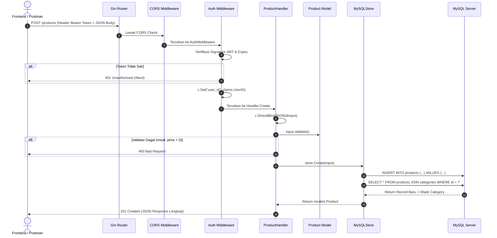

# Panduan Lengkap Memahami Proyek (Golang Learning Guide)

Dokumen ini disusun khusus sebagai **panduan belajar komprehensif** untuk memahami arsitektur, pola desain (_design pattern_), alur eksekusi, serta idiom-idiom bahasa Go yang diimplementasikan di dalam proyek **Go CRUD API**.

---

## 1. Peta Konsep Utama Golang pada Proyek Ini

Jika Anda sedang belajar Golang, proyek ini mencakup konsep-konsep inti yang umum digunakan di industri backend enterprise modern:

| Konsep Golang                 | Lokasi Penerapan                            | Penjelasan Singkat                                                               |
| :---------------------------- | :------------------------------------------ | :------------------------------------------------------------------------------- |
| **Struct & Custom Types**     | `internal/models/`                          | Merepresentasikan entitas data dan skema database.                               |
| **Pointers vs Values**        | `models/product.go`, `store/mysql_store.go` | Pointer (`*Category`) digunakan untuk relasi data nullable dan efisiensi memori. |
| **Interfaces (Kontrak)**      | `internal/store/store.go`                   | Menerapkan Repository Pattern: decoupling antara logika HTTP dan database.       |
| **Concurrency & Mutex**       | `internal/store/store.go`                   | Menggunakan `sync.RWMutex` untuk mengamankan data in-memory dari race condition. |
| **Goroutines & Channels**     | `cmd/server/main.go`                        | Menjalankan HTTP server di latar belakang dan menangkap sinyal shutdown OS.      |
| **Error Handling & Sentinel** | `internal/store/store.go`, `handlers/`      | Menggunakan variabel error statis (`ErrNotFound`) dan `errors.Is`.               |
| **Higher-Order Functions**    | `internal/middleware/`                      | Middleware di Gin berupa fungsi yang mengembalikan `gin.HandlerFunc`.            |
| **Context & Timeouts**        | `cmd/server/main.go`                        | `context.WithTimeout` untuk membatasi durasi operasi graceful shutdown.          |
| **Table-Driven Tests**        | `internal/models/*_test.go`                 | Standar resmi penulisan unit test di ekosistem Go.                               |

---

## 2. Struktur Proyek & Filosofi Desain

Aplikasi ini menggunakan pola arsitektur **Clean Architecture sederhana (Layered Architecture)** dengan struktur direktori standar komunitas Go (_Standard Go Project Layout_):

```text
go-crud-api/
├── cmd/
│   └── server/
│       └── main.go                 # [1] Composition Root & Bootstrap server
├── docs/
│   ├── technical_specification.md  # [2] Spesifikasi teknis, skema DB, kontrak API
│   ├── learning_guide.md           # [3] Panduan pemahaman & materi belajar (file ini)
│   └── postman_collection.json     # [4] Koleksi Postman v2.1 siap pakai (Auto JWT)
├── internal/                       # [4] Kode privat yang tidak bisa diimpor modul luar
│   ├── config/                     # [5] Konfigurasi environment (.env)
│   ├── database/                   # [6] Database seeder & manajemen data awal
│   ├── handlers/                   # [7] HTTP Delivery Layer (Controllers)
│   ├── middleware/                 # [8] Interceptor request (Auth JWT & CORS)
│   ├── models/                     # [9] Domain Entities & Aturan Validasi
│   ├── routes/                     # [10] Setup Routing & Grouping Endpoint Gin
│   └── store/                      # [11] Data Access Layer (Repository Pattern)
├── .air.toml                       # [12] Konfigurasi live-reload Air
├── .env                            # [13] Kredensial lingkungan lokal
├── api.http                        # [14] Koleksi request HTTP untuk uji coba via REST Client
├── go.mod                          # [15] Manifest dependensi Go
└── go.sum                          # [16] Checksum integritas dependensi
```

### Mengapa menggunakan folder `internal/`?

Di Golang, folder bernama `internal` memiliki perlakuan khusus oleh compiler. Paket apa pun di dalam `internal/` **hanya bisa diimpor oleh modul ini sendiri**, dan tidak bisa diimpor oleh proyek eksternal lain. Ini menjaga kode inti kita tetap terenkapsulasi secara aman.

---

## 3. Bedah Komponen Lapisan demi Lapisan

Mari kita pelajari setiap lapisan dari yang terdalam (Domain) hingga yang terluar (Entrypoint).

### A. Lapisan Model (`internal/models/`)

Lapisan ini berisi entitas data murni dan aturan bisnis dasar.

1. **`category.go`**:
   - Mendefinisikan struct `Category` dengan field `ID`, `Name`, serta audit timestamp.
   - Menggunakan tag `gorm:"unique"` agar nama kategori tidak boleh kembar.
2. **`product.go`**:
   - Mendefinisikan struct `Product` yang memiliki relasi ke `Category` (`CategoryID uint` dan `Category *Category`).
   - **Pelajaran Penting**: Mengapa `Category` berupa pointer (`*Category`)?
     - Jika kategori belum di-load atau bernilai null, nilainya bisa menjadi `nil`.
     - Menghindari recursive copy pada memori.
     - Tag `json:",omitempty"` memastikan jika pointer bernilai `nil`, field tersebut diabaikan di JSON.
3. **`user.go`**:
   - Menyimpan akun login.
   - **Pelajaran Keamanan**: Tag `json:"-"` pada `Password` memastikan password tidak pernah bocor ke output JSON API.
   - **GORM Hook (`BeforeSave`)**: Hook ini berjalan otomatis sebelum data masuk ke MySQL untuk mengubah password plain menjadi hash **Bcrypt**.

---

### B. Lapisan Repositori / Penyimpanan (`internal/store/`)

Lapisan ini bertanggung jawab untuk operasi database (CRUD).

1. **Interface `Store` ([store.go](file:///c:/Users/mmdbc/Development/Personal/Sandbox/Golang/go-crud-api/internal/store/store.go))**:
   - Ini adalah **kontrak**. Handler tidak peduli apakah data disimpan di MySQL, PostgreSQL, atau Memori RAM. Handler hanya tahu metode yang ada di interface ini.
   - Idiom Go: _"Accept interfaces, return structs"_.
2. **`InMemoryStore` ([store.go](file:///c:/Users/mmdbc/Development/Personal/Sandbox/Golang/go-crud-api/internal/store/store.go))**:
   - Menyimpan data di dalam `map[uint]models.Product` di memori RAM.
   - **Pelajaran Concurrency**: Di Go, server HTTP menangani setiap request pada Goroutine terpisah. Jika dua request menulis ke map secara bersamaan, Go akan crash dengan error `concurrent map read and write`.
   - Solusi: Dilindungi dengan `sync.RWMutex`.
     - `mu.RLock()`: Saat membaca (bisa dibaca ramai-ramai).
     - `mu.Lock()`: Saat menambah/mengubah (hanya 1 goroutine yang boleh menulis).
3. **`MySQLStore` ([mysql_store.go](file:///c:/Users/mmdbc/Development/Personal/Sandbox/Golang/go-crud-api/internal/store/mysql_store.go))**:
   - Implementasi query database menggunakan GORM ORM.
   - **Eager Loading**: `.Preload("Category")` secara otomatis mengambil data kategori yang terikat pada produk (mencegah masalah query N+1).
   - **Soft Delete**: Karena struct memiliki `gorm.DeletedAt`, pemanggilan `db.Delete` akan mengubah kolom `deleted_at = NOW()` tanpa menghapus baris secara permanen.

---

### C. Lapisan Middleware (`internal/middleware/`)

Lapisan ini menyaring atau memodifikasi request sebelum sampai ke controller/handler.

1. **`auth.go` (JWT Middleware)**:
   - Memeriksa header `Authorization: Bearer <TOKEN>`.
   - Memverifikasi tanda tangan kriptografi token JWT dengan algoritma HMAC-SHA256 (`jwt.SigningMethodHMAC`).
   - Menyimpan `user_id` ke dalam context Gin via `c.Set("user_id", claims.UserID)` agar handler berikutnya dapat mengetahui siapa yang melakukan request.
   - Jika token salah/kadaluarsa, panggil `c.AbortWithStatusJSON(401, ...)` agar request terhenti seketika.
2. **`middleware.go` (CORS)**:
   - Mengatur header CORS (`Access-Control-Allow-Origin`, dll.) agar API bisa diakses oleh aplikasi web frontend (seperti React / Vue / Vite).
   - Menangani request pre-flight browser berjenis `OPTIONS` dengan HTTP 204 No Content.

---

### D. Lapisan Handler / Controller (`internal/handlers/`)

Lapisan ini menerima HTTP request, memvalidasi input JSON, memanggil Store, dan mengembalikan respons JSON.

- **Dependency Injection**:
  ```go
  type ProductHandler struct {
      store store.Store // Handler hanya bergantung pada Interface!
  }
  ```
- **Alur Kerja Handler**:
  1. `c.ShouldBindJSON(&input)`: Mengurai request body JSON ke dalam struct.
  2. `input.Validate()`: Memeriksa validitas data (nama tidak boleh kosong, harga/stok tidak boleh negatif).
  3. Memanggil metode store (misal: `h.store.Create(input)`).
  4. Mengembalikan HTTP Status Code yang tepat:
     - `200 OK`: Pengambilan data sukses atau update sukses.
     - `201 Created`: Pembuatan resource baru sukses.
     - `204 No Content`: Penghapusan sukses tanpa perlu kirim body response.
     - `400 Bad Request`: Input client tidak valid.
     - `401 Unauthorized`: Token tidak ada atau salah password.
     - `404 Not Found`: Data dengan ID tersebut tidak ditemukan.
     - `409 Conflict`: Email sudah terdaftar.
     - `500 Internal Server Error`: Kesalahan server/database yang tak terduga.

---

### E. Lapisan Database & Seeder (`internal/database/`)

Lapisan ini mengisolasi seluruh detail teknis database dari `main.go`.

1. **`database.go`**:
   - Menangani perakitan DSN MySQL, pembukaan koneksi `gorm.Open`, dan pengaturan batas *Connection Pooling* (`SetMaxIdleConns: 10`, `SetMaxOpenConns: 100`, `SetConnMaxLifetime: 1 Jam`).
   - Menjalankan *Auto-Migration* untuk sinkronisasi skema tabel `categories`, `products`, dan `users`.
   - Menangani flag reset `-fresh` (`SET FOREIGN_KEY_CHECKS = 0` dan `DropTable`) secara aman.
2. **`seeder.go`**:
   - Menerapkan prinsip *Idempotent Seeding*: memeriksa apakah data sudah ada (`count == 0`) sebelum menyemai kategori dan produk awal agar tidak terjadi duplikasi data saat server restart.

---

### F. Lapisan Routing (`internal/routes/`)

Lapisan ini mengatur bagaimana request HTTP diarahkan ke handler yang tepat.

1. **`routes.go`**:
   - Memisahkan pemasangan rute dari `main.go` agar penambahan ratusan endpoint di masa depan tetap terorganisir.
   - **Route Grouping**: Mengelompokkan rute publik (`/register`, `/login`, `GET /products`) dan rute terproteksi (`POST`, `PUT`, `DELETE /products`, `/me`) menggunakan `r.Group("")` yang dibungkus oleh `middleware.AuthMiddleware`.

---

### G. Lapisan Bootstrap Server (`cmd/server/main.go`)

Lapisan ini adalah tempat merakit (_composition root_) seluruh komponen aplikasi.

#### Alur Eksekusi main() (High-Level Orchestration):

1. **Inisialisasi Structured Logger**: Menggunakan `slog.NewJSONHandler` bawaan Go 1.21+ untuk log terstruktur ramah mesin.
2. **Parsing CLI Flag**: `flag.Bool("fresh", false, ...)` untuk opsi drop tabel dan re-seed (`-fresh`).
3. **Pemuatan Konfigurasi**: Memanggil `config.Load()` untuk membaca file `.env` atau environment OS.
4. **Inisialisasi Database Terpadu (`database.Init`)**:
   - Membuka koneksi MySQL via GORM.
   - Mengonfigurasi Connection Pooling (`SetMaxIdleConns: 10`, `SetMaxOpenConns: 100`, `SetConnMaxLifetime: 1 Jam`).
   - Eksekusi reset tabel jika `-fresh` aktif.
   - Eksekusi `AutoMigrate` dan seeder awal otomatis (`database.Seed`).
5. **Wiring Dependency Injection**:
   - `db` disuntikkan ke `MySQLStore`.
   - `MySQLStore` disuntikkan ke `ProductHandler` dan `AuthHandler`.
6. **Pemasangan Routing Terpisah (`routes.Setup`)**:
   - Mengelompokkan rute publik dan terproteksi JWT ke dalam router Gin tanpa mengotori `main.go`.
7. **HTTP Server & Graceful Shutdown (`runServer`)**:
   - Server HTTP dijalankan di dalam goroutine terpisah (`go srv.ListenAndServe()`).
   - Channel `shutdownSignal := make(chan os.Signal, 1)` mendengarkan sinyal `Ctrl+C` atau `SIGTERM`.
   - Saat sinyal tiba, server diberi waktu 10 detik (`context.WithTimeout`) untuk menyelesaikan request pengguna sebelum dinonaktifkan dengan aman.

---

## 4. Simulasi Alur Request Nyata (Lifecycle Walkthrough)

### Skenario: Penambahan Produk Baru (`POST /products`)



---

## 5. Pola Pengujian Otomatis (Unit Testing)

Proyek ini mendemonstrasikan dua pola pengujian paling penting di Golang:

### 1. Table-Driven Testing ([product_test.go](file:///c:/Users/mmdbc/Development/Personal/Sandbox/Golang/go-crud-api/internal/models/product_test.go))

Alih-alih membuat fungsi tes berulang kali untuk setiap skenario (nama kosong, harga minus, stok minus), kita membuat tabel slice struct:

```go
tests := []struct {
    name    string
    product Product
    wantErr bool
}{
    {"Produk valid", Product{...}, false},
    {"Harga negatif harus error", Product{...}, true},
}
```

Lalu melakukan perulangan menggunakan subtest `t.Run(tt.name, func(t *testing.T) { ... })`.

### 2. Mocking Menggunakan In-Memory Store & httptest ([product_handler_test.go](file:///c:/Users/mmdbc/Development/Personal/Sandbox/Golang/go-crud-api/internal/handlers/product_handler_test.go))

Karena kita menggunakan interface `Store`, kita tidak perlu menyalakan MySQL asli untuk menguji controller:

```go
s := store.NewInMemoryStore()
h := NewProductHandler(s)
rec := httptest.NewRecorder()
c, _ := gin.CreateTestContext(rec)
```

Pengujian ini berjalan dalam hitungan milidetik dan 100% independen!

---

## 6. Latihan Mandiri untuk Memperdalam Penguasaan Golang

Untuk menguji dan memperdalam pemahaman Anda terhadap arsitektur ini, cobalah tantangan praktik berikut:

1. **Tantangan 1: CRUD Kategori Lengkap**
   - Buat endpoint `GET /categories` dan `POST /categories`.
   - Tambahkan fungsi `GetAllCategories` dan `CreateCategory` pada interface `Store`, lalu implementasikan di `InMemoryStore` dan `MySQLStore`.
2. **Tantangan 2: Fitur Pencarian Produk (Search)**
   - Modifikasi endpoint `GET /products?search=keyboard` agar bisa mencari produk berdasarkan nama yang cocok (_LIKE query_).
3. **Tantangan 3: Pagination**
   - Tambahkan query parameter `?page=1&limit=10` pada `GET /products` agar API tidak langsung mengambil seluruh data produk sekaligus saat data sudah berjumlah ribuan.
4. **Tantangan 4: Role-Based Authorization**
   - Tambahkan kolom `role` (enum: `admin`, `user`) pada model `User`.
   - Modifikasi middleware agar hanya user dengan role `admin` yang diizinkan melakukan operasi `POST`, `PUT`, dan `DELETE` produk.
