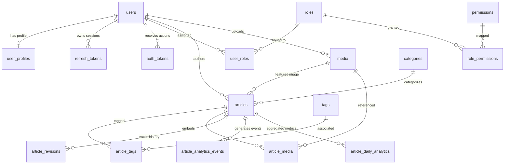

# Database Data Dictionary & Entity Relationships

**Document Type:** Technical Reference & Entity Relationship Guide  
**Target Audience:** System Architects, Database Administrators, and Engineers  
**Database Engine:** MySQL 8.0+ (InnoDB, UTF-8 Unicode `utf8mb4_0900_ai_ci`)

---

## 1. Entity Relationship Overview

---

## 2. Table Specifications

### 2.1 Identity, Profiles, & Sessions

#### `users`

Core user credentials and lifecycle status.

- `id`: `CHAR(26)` PK (ULID).
- `username`: `VARCHAR(50)` NOT NULL, UNIQUE.
- `email`: `VARCHAR(255)` NOT NULL, UNIQUE.
- `password_hash`: `VARCHAR(255)` NOT NULL (Argon2id hash string).
- `role`: `ENUM('admin', 'user')` NOT NULL DEFAULT `'user'`.
- `status`: `ENUM('active', 'inactive', 'pending_verification', 'suspended')` NOT NULL DEFAULT `'active'`.
- `email_verified_at`: `DATETIME` NULL.
- `created_at`: `DATETIME` NOT NULL.
- `updated_at`: `DATETIME` NOT NULL.

#### `user_profiles`

Extended profile information for a user.

- `user_id`: `CHAR(26)` PK / FK references `users(id)` ON DELETE CASCADE.
- `full_name`: `VARCHAR(100)` NOT NULL DEFAULT `''`.
- `bio`: `TEXT` NULL.
- `phone_number`: `VARCHAR(20)` NULL.
- `avatar_url`: `VARCHAR(500)` NULL.
- `created_at`: `DATETIME` NOT NULL.
- `updated_at`: `DATETIME` NOT NULL.

#### `refresh_tokens`

Stateful session tracking supporting Refresh Token Rotation (RTR).

- `id`: `CHAR(26)` PK (ULID).
- `user_id`: `CHAR(26)` FK references `users(id)` ON DELETE CASCADE.
- `token_hash`: `VARCHAR(64)` NOT NULL UNIQUE (SHA-256 of raw refresh token).
- `token_family`: `VARCHAR(64)` NOT NULL (Lineage tracking ID).
- `is_revoked`: `BOOLEAN` NOT NULL DEFAULT `FALSE`.
- `expires_at`: `DATETIME` NOT NULL.
- `created_at`: `DATETIME` NOT NULL.
- `user_agent`: `VARCHAR(500)` NULL.
- `ip_address`: `VARCHAR(45)` NULL.

#### `auth_tokens`

One-time cryptographic tokens for email verification and password reset.

- `id`: `CHAR(26)` PK (ULID).
- `user_id`: `CHAR(26)` FK references `users(id)` ON DELETE CASCADE.
- `token_hash`: `VARCHAR(64)` NOT NULL UNIQUE (SHA-256 of raw action token).
- `token_type`: `ENUM('email_verification', 'password_reset', 'email_change')` NOT NULL.
- `payload`: `VARCHAR(255)` NULL (stores pending email during email changes).
- `is_used`: `BOOLEAN` NOT NULL DEFAULT `FALSE`.
- `expires_at`: `DATETIME` NOT NULL.
- `created_at`: `DATETIME` NOT NULL.

---

### 2.2 Granular RBAC (Roles & Permissions)

#### `roles`

Role definitions.

- `id`: `CHAR(26)` PK (ULID).
- `name`: `VARCHAR(50)` NOT NULL UNIQUE (e.g. `super_admin`, `admin`, `editor`, `author`).
- `display_name`: `VARCHAR(100)` NOT NULL.
- `description`: `TEXT` NULL.
- `created_at`: `DATETIME` NOT NULL.
- `updated_at`: `DATETIME` NOT NULL.

#### `permissions`

Granular permission descriptors.

- `id`: `CHAR(26)` PK (ULID).
- `name`: `VARCHAR(100)` NOT NULL UNIQUE (Syntax: `resource.action`, e.g. `articles.create`).
- `description`: `TEXT` NULL.
- `created_at`: `DATETIME` NOT NULL.
- `updated_at`: `DATETIME` NOT NULL.

#### `role_permissions`

Pivot table mapping permissions to roles.

- `role_id`: `CHAR(26)` FK references `roles(id)` ON DELETE CASCADE.
- `permission_id`: `CHAR(26)` FK references `permissions(id)` ON DELETE CASCADE.
- Primary Key: `(role_id, permission_id)`.

#### `user_roles`

Pivot table mapping roles to users.

- `user_id`: `CHAR(26)` FK references `users(id)` ON DELETE CASCADE.
- `role_id`: `CHAR(26)` FK references `roles(id)` ON DELETE CASCADE.
- Primary Key: `(user_id, role_id)`.

---

### 2.3 Content, Media, & Taxonomy

#### `categories`

Article taxonomy classification.

- `id`: `CHAR(26)` PK (ULID).
- `name`: `VARCHAR(100)` NOT NULL UNIQUE.
- `slug`: `VARCHAR(120)` NOT NULL UNIQUE.
- `description`: `TEXT` NULL.
- `created_at`: `DATETIME` NOT NULL.
- `updated_at`: `DATETIME` NOT NULL.

#### `tags`

Tag taxonomy.

- `id`: `CHAR(26)` PK (ULID).
- `name`: `VARCHAR(50)` NOT NULL UNIQUE.
- `slug`: `VARCHAR(60)` NOT NULL UNIQUE.
- `created_at`: `DATETIME` NOT NULL.
- `updated_at`: `DATETIME` NOT NULL.

#### `media`

Centralized media asset library.

- `id`: `CHAR(26)` PK (ULID).
- `uploaded_by`: `CHAR(26)` FK references `users(id)` ON DELETE SET NULL.
- `filename`: `VARCHAR(255)` NOT NULL.
- `storage_disk`: `ENUM('local', 's3', 'r2')` NOT NULL.
- `storage_key`: `VARCHAR(500)` NOT NULL UNIQUE.
- `url`: `VARCHAR(500)` NOT NULL.
- `mime_type`: `VARCHAR(100)` NOT NULL.
- `size`: `BIGINT` NOT NULL.
- `width`: `INT` NULL.
- `height`: `INT` NULL.
- `created_at`: `DATETIME` NOT NULL.
- `updated_at`: `DATETIME` NOT NULL.

#### `articles`

Article content management.

- `id`: `CHAR(26)` PK (ULID).
- `author_id`: `CHAR(26)` FK references `users(id)` ON DELETE CASCADE.
- `category_id`: `CHAR(26)` NULL FK references `categories(id)` ON DELETE SET NULL.
- `featured_image_id`: `CHAR(26)` NULL FK references `media(id)` ON DELETE SET NULL.
- `og_image_id`: `CHAR(26)` NULL FK references `media(id)` ON DELETE SET NULL.
- `title`: `VARCHAR(255)` NOT NULL.
- `slug`: `VARCHAR(280)` NOT NULL UNIQUE.
- `excerpt`: `TEXT` NULL.
- `content`: `LONGTEXT` NOT NULL (Clean sanitized HTML).
- `status`: `ENUM('draft', 'scheduled', 'published', 'archived')` NOT NULL DEFAULT `'draft'`.
- `is_featured`: `BOOLEAN` NOT NULL DEFAULT `FALSE`.
- `reading_time_minutes`: `INT` NOT NULL DEFAULT 0.
- `views_count`: `BIGINT` NOT NULL DEFAULT 0.
- `scheduled_at`: `DATETIME` NULL.
- `published_at`: `DATETIME` NULL.
- `deleted_at`: `DATETIME` NULL (Soft delete).
- `created_at`: `DATETIME` NOT NULL.
- `updated_at`: `DATETIME` NOT NULL.

#### `article_tags`

Pivot table for article tags.

- `article_id`: `CHAR(26)` FK references `articles(id)` ON DELETE CASCADE.
- `tag_id`: `CHAR(26)` FK references `tags(id)` ON DELETE CASCADE.
- Primary Key: `(article_id, tag_id)`.

#### `article_media`

Tracks embedded media assets in article content.

- `article_id`: `CHAR(26)` FK references `articles(id)` ON DELETE CASCADE.
- `media_id`: `CHAR(26)` FK references `media(id)` ON DELETE RESTRICT (Protects in-use media from deletion).
- Primary Key: `(article_id, media_id)`.

#### `article_revisions`

Historical snapshot created on every article update.

- `id`: `CHAR(26)` PK (ULID).
- `article_id`: `CHAR(26)` FK references `articles(id)` ON DELETE CASCADE.
- `author_id`: `CHAR(26)` FK references `users(id)` ON DELETE CASCADE.
- `title`: `VARCHAR(255)` NOT NULL.
- `slug`: `VARCHAR(280)` NOT NULL.
- `excerpt`: `TEXT` NULL.
- `content`: `LONGTEXT` NOT NULL.
- `revision_number`: `INT` NOT NULL.
- `created_at`: `DATETIME` NOT NULL.

---

### 2.4 Privacy-Preserving Engagement Analytics

#### `article_analytics_events`

High-frequency raw visitor events.

- `id`: `BIGINT AUTO_INCREMENT` PK.
- `article_id`: `CHAR(26)` FK references `articles(id)` ON DELETE CASCADE.
- `event_id`: `CHAR(26)` NOT NULL UNIQUE (Client idempotency key).
- `visitor_id`: `VARCHAR(64)` NOT NULL (Pseudonymized salted hash).
- `session_id`: `VARCHAR(64)` NULL.
- `event_type`: `ENUM('view', 'read', 'scroll', 'share')` NOT NULL.
- `reading_time_seconds`: `INT` NOT NULL DEFAULT 0.
- `scroll_depth`: `INT` NOT NULL DEFAULT 0.
- `created_at`: `DATETIME` NOT NULL.

#### `article_daily_analytics`

Hourly aggregated engagement rollups per article.

- `id`: `CHAR(26)` PK (ULID).
- `article_id`: `CHAR(26)` FK references `articles(id)` ON DELETE CASCADE.
- `analytics_date`: `DATE` NOT NULL.
- `total_views`: `INT` NOT NULL DEFAULT 0.
- `unique_visitors`: `INT` NOT NULL DEFAULT 0.
- `total_shares`: `INT` NOT NULL DEFAULT 0.
- `total_reading_time`: `BIGINT` NOT NULL DEFAULT 0.
- `created_at`: `DATETIME` NOT NULL.
- `updated_at`: `DATETIME` NOT NULL.
- Unique Key: `(article_id, analytics_date)`.

#### rticle_related

Pivot table for manually curated related articles.

- rticle_id: CHAR(26) FK references rticles(id) ON DELETE CASCADE.
- elated_article_id: CHAR(26) FK references rticles(id) ON DELETE CASCADE.
- created_at: DATETIME NOT NULL.
- Primary Key: (article_id, related_article_id).

---

### 2.5 Global Settings

#### settings

System-wide configuration store for dynamic platform settings.

- id: CHAR(26) PK (ULID).
- setting_key: VARCHAR(100) NOT NULL UNIQUE.
- setting_value: JSON NOT NULL.
- updated_at: DATETIME NOT NULL.
