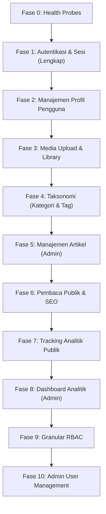

# Panduan Pengujian API Menggunakan Postman

Panduan ini mendokumentasikan langkah demi langkah pengujian seluruh endpoint **Go REST API Starter Kit** menggunakan Postman. Koleksi Postman resmi telah disediakan di dalam repository pada file [docs/postman_collection.json](postman_collection.json) dengan total **71 request siap uji**.

---

## 1. Persiapan & Import Koleksi

### 1.1 Cara Import ke Postman

1. Buka aplikasi **Postman** (Desktop Client atau Web Agent).
2. Klik tombol **Import** di pojok kiri atas workspace Anda.
3. Pilih tab **File** dan arahkan ke file [docs/postman_collection.json](postman_collection.json), atau drag & drop file tersebut ke jendela Postman.
4. Klik **Import**. Koleksi dengan nama **`Go REST API Starter Kit (ULID + RBAC + Articles & Analytics)`** akan muncul di sidebar koleksi Anda.

### 1.2 Konfigurasi Collection Variables

Koleksi ini menggunakan **Collection Variables** terintegrasi. Anda dapat memeriksa nilainya dengan mengklik nama koleksi lalu memilih tab **Variables**:

| Variabel             | Deskripsi                                                         | Cara Pengisian / Sumber Nilai                                                                                     |
| :------------------- | :---------------------------------------------------------------- | :---------------------------------------------------------------------------------------------------------------- |
| `baseUrl`            | Alamat host server API lokal                                      | Default: `http://localhost:8080`                                                                                  |
| `accessToken`        | JWT Access Token (Aktif 15 menit)                                 | **Otomatis diisi** saat `1.2 Login` atau `1.3 Refresh Token` berhasil (Status `200 OK`)                           |
| `refreshToken`       | Token rotasi sesi (Aktif 7 hari)                                  | **Otomatis diisi** saat `1.2 Login` atau `1.3 Refresh Token`, otomatis dikosongkan saat `1.4 Logout`              |
| `sampleToken`        | Token aksi (Verifikasi email / Reset password / Konfirmasi email) | **Manual**: Salin token 64-karakter dari box terminal `LogMailer` lalu tempel di tab Variables                    |
| `sampleArticleId`    | ULID 26-karakter artikel uji                                      | **Otomatis diisi** saat `3.2 Buat Artikel Baru` (Status `201 Created`), atau salin ID dari response               |
| `sampleCategoryId`   | ULID 26-karakter kategori uji                                     | **Otomatis diisi** saat `3.8 Buat Kategori Baru` (Status `201 Created`), atau salin ID dari response              |
| `sampleTagId`        | ULID 26-karakter tag uji                                          | **Otomatis diisi** saat `3.13 Buat Tag Baru` (Status `201 Created`), atau salin ID dari response                  |
| `sampleMediaId`      | ULID 26-karakter media aset uji                                   | **Otomatis diisi** saat `3.17 Upload Media Library` (Status `201 Created`), atau salin ID dari response           |
| `sampleRoleId`       | ULID 26-karakter role RBAC                                        | **Otomatis diisi** saat `5.3 Buat Role Baru` (Status `201 Created`), atau salin ID dari response                  |
| `samplePermissionId` | ULID 26-karakter izin sistem                                      | **Otomatis diisi** saat `5.8 Buat Permission Baru` (Status `201 Created`), atau salin ID dari response            |
| `sampleUserId`       | ULID 26-karakter user target admin                                | **Otomatis diisi** saat `1.1 Register Akun Baru` (Status `201 Created`), atau salin ID dari `6.1 Daftar Pengguna` |

> [!IMPORTANT]
> **Cara Mengisi Variabel Manual di Postman:**
>
> 1. Klik nama koleksi **`Go REST API Starter Kit...`** di sidebar kiri Postman.
> 2. Klik tab **Variables** di panel utama.
> 3. Cari nama variabel pada kolom **Variable** (misal: `sampleToken`).
> 4. Tempel nilai yang baru disalin ke kolom **Current Value**.
> 5. Tekan tombol **Save** (`Ctrl + S` atau tombol oranye di kanan atas).

---

## 2. Alur Pengujian Berurutan (Step-by-Step Testing Workflow)

Ikuti urutan fase pengujian berikut agar setiap request mendapatkan data dependensi yang diperlukan. Seluruh **71 request** diuji secara sistematis:



---

### Fase 0: Verifikasi Health & Readiness Probes

Buka folder **`0. System Health & Probes`**:

1. **0.1 Full Health Check** (`GET {{baseUrl}}/health`):
   - Memastikan koneksi HTTP server dan pool koneksi database MySQL berstatus aktif.
   - Status yang diharapkan: `200 OK` (`{"status":"ok","database":"healthy"}`).
2. **0.2 Liveness Probe** (`GET {{baseUrl}}/health/live`):
   - Memverifikasi lifecycle process container. Status: `200 OK` (`{"status":"live"}`).
3. **0.3 Readiness Probe** (`GET {{baseUrl}}/health/ready`):
   - Memverifikasi kesiapan menerima traffic ingress. Status: `200 OK` (`{"status":"ready","database":"healthy"}`).

---

### Fase 1: Autentikasi & Manajemen Sesi (Folder `1. Authentication`)

Pada fase ini, kita akan menguji seluruh siklus hidup autentikasi: pendaftaran akun, verifikasi email, login, rotasi refresh token, penggantian password, logout, serta alur lupa dan reset password.

1. **1.1 Register Akun Baru** (`POST {{baseUrl}}/api/v1/auth/register`):
   - Body JSON default:
     ```json
     {
       "username": "johndoe",
       "email": "john@example.com",
       "password": "password123",
       "full_name": "John Doe"
     }
     ```
   - Status: `201 Created`. Postman Tests script otomatis menangkap token.
   - Server mencatat email verifikasi di terminal (`LogMailer`).

2. **1.8 & 1.9 Verifikasi Email Akun Baru**:
   - Buka konsol terminal tempat server backend berjalan. Cari box:
     ```text
     ┌──────────────────────────────────────────────────────────────────────────┐
     │ 📧 [DEV MAILER / CONSOLE LOG] - NEW ACCOUNT EMAIL VERIFICATION            │
     │ Action Link: http://localhost:3000/verify-email?token=abcdef123456...   │
     └──────────────────────────────────────────────────────────────────────────┘
     ```
   - Salin token 64-karakter tersebut.
   - **Tempel ke variabel `sampleToken` di tab Variables koleksi Postman lalu Save (`Ctrl + S`).**
   - Jalankan **1.8 Verifikasi Email (Token via Query)** (`POST {{baseUrl}}/api/v1/auth/verify-email?token={{sampleToken}}`). Status: `200 OK` (menggunakan `POST` demi mencegah konsumsi token otomatis oleh web crawler / scanner email).
   - _(Alternatif)_ Anda juga dapat menguji **1.9 Verifikasi Email (Token via Body)** (`POST {{baseUrl}}/api/v1/auth/verify-email`). Status: `200 OK`.

3. **1.10 Kirim Ulang Email Verifikasi** (`POST {{baseUrl}}/api/v1/auth/resend-verification`):
   - Body: `{"email": "john@example.com"}`.
   - Status: `200 OK`. Menguji pembuatan token baru jika token lama kedaluwarsa.

4. **1.2 Login Super Admin** (`POST {{baseUrl}}/api/v1/auth/login`):
   - Masukkan kredensial administrator default:
     ```json
     {
       "email": "admin@mmdbconnect.com",
       "password": "adminpassword123"
     }
     ```
   - Status: `200 OK`.
   - **Postman Tests script otomatis memperbarui `accessToken` dan `refreshToken` di variabel koleksi.** Seluruh request ber-role admin pada langkah selanjutnya langsung terautentikasi otomatis!

5. **1.3 Refresh Token Rotation (RTR)** (`POST {{baseUrl}}/api/v1/auth/refresh`):
   - Menguji rotasi token tanpa login ulang. Status: `200 OK`.
   - Server mencabut refresh token lama dan mengeluarkan pasangan token baru. Skrip Postman otomatis menyimpan token baru ke variabel.

6. **1.5 Ganti Password** (`POST {{baseUrl}}/api/v1/auth/change-password`):
   - Body:
     ```json
     {
       "old_password": "adminpassword123",
       "new_password": "newpassword12345"
     }
     ```
   - Status: `200 OK`. Password berhasil diubah.
   - _(Kembalikan password)_ Kirim request kembali dengan `old_password: "newpassword12345"` dan `new_password: "adminpassword123"` agar kredensial admin kembali normal.

7. **1.4 Logout** (`POST {{baseUrl}}/api/v1/auth/logout`):
   - Status: `200 OK`. Menguji pencabutan sesi aktif dan pembatalan refresh token (`refresh_token` dicabut di DB).
   - Setelah logout, token lama tidak dapat digunakan lagi untuk refresh.

8. **1.6 Lupa Password (Forgot Password)** (`POST {{baseUrl}}/api/v1/auth/forgot-password`):
   - Body: `{"email": "admin@mmdbconnect.com"}`.
   - Status: `200 OK` (menerapkan prinsip _anti-enumeration_).
   - Buka konsol terminal server, cari box `PASSWORD RESET REQUEST`. Salin token 64-karakternya.
   - **Tempel token tersebut ke variabel `sampleToken` di Postman dan Save (`Ctrl + S`).**

9. **1.7 Reset Password (dengan Token)** (`POST {{baseUrl}}/api/v1/auth/reset-password`):
   - Request otomatis menyertakan `"token": "{{sampleToken}}"` dan `"new_password": "adminpassword123"`.
   - Status: `200 OK`. Password akun admin berhasil direset.

10. **Login Ulang Administrator**:
    - Jalankan kembali **1.2 Login** (`POST {{baseUrl}}/api/v1/auth/login`) dengan password `adminpassword123`.
    - Status: `200 OK`. Langkah ini penting agar variabel `{{accessToken}}` terisi kembali dengan token aktif untuk melanjutkan pengujian modul berikutnya.

---

### Fase 2: Manajemen Profil Pengguna (Folder `2. User Management`)

1. **2.1 Profil Saya (/me)** (`GET {{baseUrl}}/api/v1/users/me`):
   - Status: `200 OK`. Menampilkan profil pengguna yang sedang login (`id`, `username`, `email`, `role`, `profile`).
2. **2.2 Update Profil Saya** (`PUT {{baseUrl}}/api/v1/users/profile`):
   - Body: `{"full_name": "Mochammad Bagas", "bio": "Software Engineer", "phone_number": "+6281234567890"}`.
   - Status: `200 OK`.
3. **2.3 Upload Avatar** (`POST {{baseUrl}}/api/v1/users/avatar`):
   - Tab **Body** $\rightarrow$ pilih **form-data**.
   - Kolom Key: **`avatar`** (tipe **File**). Pilih file gambar asli (`.png` atau `.jpg`).
   - Status: `200 OK` (`{"avatar_url": "/uploads/avatars/..."}`).
4. **2.4 Hapus Avatar** (`DELETE {{baseUrl}}/api/v1/users/avatar`):
   - Status: `200 OK`. Foto profil dihapus dari penyimpanan.
5. **2.5 Ubah Username** (`PUT {{baseUrl}}/api/v1/users/username`):
   - Ubah username akun aktif. Status: `200 OK`. (Setelah uji, kembalikan ke `admin`).
6. **2.6 Cek Status Akun** (`GET {{baseUrl}}/api/v1/users/status`):
   - Status: `200 OK`. Menampilkan status verifikasi email dan akun aktif.
7. **2.7 Permintaan Ganti Email** (`POST {{baseUrl}}/api/v1/users/email/request-change`):
   - Body: `{"new_email": "newadmin@example.com", "password": "adminpassword123"}`.
   - Status: `200 OK`.
   - Buka terminal server, cari box `EMAIL CHANGE CONFIRMATION`. Salin token 64-karakternya.
   - **Tempel token tersebut ke variabel `sampleToken` di Postman dan Save (`Ctrl + S`).**
8. **2.8 Konfirmasi Ganti Email (Token via Query)** (`POST {{baseUrl}}/api/v1/users/email/confirm-change?token={{sampleToken}}`):
   - Status: `200 OK`. Email berhasil diganti.
   - _(Alternatif)_ **2.9 Konfirmasi Ganti Email (Token via Body)** (`POST {{baseUrl}}/api/v1/users/email/confirm-change`).

---

### Fase 3: Media Upload & Library Management (Folder `3. Admin Management`)

1. **3.17 Upload Media Library** (`POST {{baseUrl}}/api/v1/admin/media`):
   - Tab **Body** $\rightarrow$ pilih **form-data**.
   - Kolom Key: **`image`** (tipe **File**). Pilih file gambar asli (`.jpg`, `.png`, atau `.webp`).
   - Status: `201 Created`.
   - **Salin nilai `"id"` dari response JSON (contoh: `01M7MED...`) lalu tempel ke variabel `sampleMediaId` di tab Variables Postman dan Save (`Ctrl + S`).**
2. **3.18 Daftar Media Library (Admin)** (`GET {{baseUrl}}/api/v1/admin/media?page=1&per_page=20`):
   - Status: `200 OK`. Menampilkan daftar seluruh media yang tersimpan beserta URL dan dimensinya.
3. **3.19 Detail Media (Admin by ULID)** (`GET {{baseUrl}}/api/v1/admin/media/{{sampleMediaId}}`):
   - Status: `200 OK`. Menampilkan metadata spesifik aset media.
4. **3.20 Hapus Media (Admin by ULID)** (`DELETE {{baseUrl}}/api/v1/admin/media/{{sampleMediaId}}`):
   - Status: `200 OK` (`{"message": "media deleted successfully"}`).
   - _(Catatan: Simpan media ini untuk digunakan pada artikel terlebih dahulu. Pengujian hapus media dapat dijalankan pada akhir pengujian untuk memverifikasi proteksi `409 MEDIA_IN_USE` jika sedang digunakan artikel)._

---

### Fase 4: Taksonomi - Kategori & Tag (Folder `3. Admin Management`)

1. **3.7 Daftar Kategori (Admin)** (`GET {{baseUrl}}/api/v1/admin/categories`):
   - Status: `200 OK`. Menampilkan daftar kategori yang tersedia.
2. **3.8 Buat Kategori Baru (Admin)** (`POST {{baseUrl}}/api/v1/admin/categories`):
   - Body JSON:
     ```json
     {
       "name": "Cloud & DevOps",
       "slug": "cloud-devops",
       "description": "Cloud computing, infrastructure as code, and containers."
     }
     ```
   - Status: `201 Created`.
   - **Salin nilai `"id"` dari response lalu tempel ke variabel `sampleCategoryId` di Postman dan Save (`Ctrl + S`).**
3. **3.9 Detail Kategori (Admin by ULID)** (`GET {{baseUrl}}/api/v1/admin/categories/{{sampleCategoryId}}`):
   - Status: `200 OK`. Mengembalikan data kategori spesifik berdasarkan ULID.
4. **3.10 Update Kategori (Admin by ULID)** (`PUT {{baseUrl}}/api/v1/admin/categories/{{sampleCategoryId}}`):
   - Perbarui nama atau deskripsi kategori. Status: `200 OK`.
5. **3.11 Hapus Kategori (Admin by ULID)** (`DELETE {{baseUrl}}/api/v1/admin/categories/{{sampleCategoryId}}`):
   - Status: `200 OK` (`{"message": "category deleted successfully"}`).
   - _(Uji proteksi)_: Jika kategori memiliki artikel terkait, server menolak penghapusan dengan status `409 CATEGORY_IN_USE`.
6. **3.12 Daftar Tags (Admin)** (`GET {{baseUrl}}/api/v1/admin/tags`):
   - Status: `200 OK`. Menampilkan daftar seluruh tag di database.
7. **3.13 Buat Tag Baru (Admin)** (`POST {{baseUrl}}/api/v1/admin/tags`):
   - Body JSON: `{"name": "Kubernetes", "slug": "kubernetes"}`. Status: `201 Created`.
   - **Salin nilai `"id"` dari response lalu tempel ke variabel `sampleTagId` di Postman dan Save (`Ctrl + S`).**
8. **3.14 Detail Tag (Admin by ULID)** (`GET {{baseUrl}}/api/v1/admin/tags/{{sampleTagId}}`):
   - Status: `200 OK`.
9. **3.15 Update Tag (Admin by ULID)** (`PUT {{baseUrl}}/api/v1/admin/tags/{{sampleTagId}}`):
   - Status: `200 OK`.
10. **3.16 Hapus Tag (Admin by ULID)** (`DELETE {{baseUrl}}/api/v1/admin/tags/{{sampleTagId}}`):
    - Status: `200 OK` (`{"message": "tag deleted successfully"}`). Relasi pada tabel junction `article_tags` otomatis terhapus via cascading.

---

### Fase 5: Manajemen Artikel Editorial (Folder `3. Admin Management`)

1. **3.2 Buat Artikel Baru** (`POST {{baseUrl}}/api/v1/admin/articles`):
   - Menggunakan `{{sampleCategoryId}}` dan `{{sampleMediaId}}` yang telah terisi:
     ```json
     {
       "title": "Arsitektur Microservices dengan Go dan Docker",
       "slug": "arsitektur-microservices-dengan-go-dan-docker",
       "category_id": "{{sampleCategoryId}}",
       "featured_image_id": "{{sampleMediaId}}",
       "excerpt": "Panduan praktis merancang arsitektur backend modular berkinerja tinggi menggunakan Go.",
       "content": "<h1>Pendahuluan</h1><p>Microservices memberikan fleksibilitas tinggi dalam deployment layanan...</p>",
       "status": "published",
       "is_featured": true,
       "tags": ["Kubernetes", "Microservices", "Golang"],
       "meta_title": "Arsitektur Microservices Go - Panduan Lengkap",
       "meta_description": "Pelajari cara membangun microservices menggunakan Go, Docker, dan MySQL."
     }
     ```
   - Status: `201 Created`.
   - **Salin nilai `"id"` dari response JSON lalu tempel ke variabel `sampleArticleId` di Postman dan Save (`Ctrl + S`).**
2. **3.3 Detail Artikel (Admin by ULID)** (`GET {{baseUrl}}/api/v1/admin/articles/{{sampleArticleId}}`):
   - Status: `200 OK`. Menampilkan relasi lengkap: kategori, array tags, URL gambar, SEO metadata, dan views.
3. **3.4 Update Artikel (Admin by ULID)** (`PUT {{baseUrl}}/api/v1/admin/articles/{{sampleArticleId}}`):
   - Ubah judul atau konten artikel, lalu kirimkan.
   - Status: `200 OK`. Karena artikel sebelumnya berstatus `published`, sistem otomatis membuat snapshot audit trail di tabel `article_revisions`.
4. **3.6 Riwayat Revisi Artikel** (`GET {{baseUrl}}/api/v1/admin/articles/{{sampleArticleId}}/revisions`):
   - Status: `200 OK`. Mengembalikan daftar snapshot versi artikel lengkap dengan user pengubah dan timestamp.
5. **3.1 Daftar Artikel (Admin)** (`GET {{baseUrl}}/api/v1/admin/articles?page=1&per_page=10`):
   - Status: `200 OK`. Menampilkan seluruh artikel (termasuk status draft dan scheduled).
6. **3.5 Hapus Artikel (Admin by ULID)** (`DELETE {{baseUrl}}/api/v1/admin/articles/{{sampleArticleId}}`):
   - Soft delete artikel (`deleted_at`). Status: `200 OK` (`{"message": "article deleted successfully"}`).

---

### Fase 6: Pembaca Publik & SEO Content Delivery (Folder `4. Public Content`)

1. **4.1 Daftar Artikel Publik** (`GET {{baseUrl}}/api/v1/articles`):
   - Menampilkan artikel berstatus `published` dengan tags batch.
   - Uji filter: `?category=tutorials-tech`, `?tag=Go`, `?is_featured=true`. Status: `200 OK`.
2. **4.2 Detail Artikel Publik by Slug** (`GET {{baseUrl}}/api/v1/articles/my-software-development-journey`):
   - Status: `200 OK`. Menyertakan teks SEO polos bersih tanpa tag HTML.
3. **4.4 Daftar Kategori Publik** (`GET {{baseUrl}}/api/v1/categories`):
   - Status: `200 OK`.
4. **4.5 Artikel Berdasarkan Slug Kategori** (`GET {{baseUrl}}/api/v1/categories/tutorials-tech/articles`):
   - Status: `200 OK`.
5. **4.6 Daftar Tag Publik** (`GET {{baseUrl}}/api/v1/tags`):
   - Status: `200 OK`.
6. **4.7 s/d 4.10 Uji Vanity URL / Alias SEO**:
   - `4.7 SEO Vanity Alias (/articles/:slug)`: `GET {{baseUrl}}/articles/published-go-article`
   - `4.8 SEO Vanity Alias (/blog/:slug)`: `GET {{baseUrl}}/blog/published-go-article`
   - `4.9 SEO Vanity Alias (/journal/:slug)`: `GET {{baseUrl}}/journal/published-go-article`
   - `4.10 SEO Vanity Alias (/categories/:slug)`: `GET {{baseUrl}}/categories/tutorials-tech`
   - Seluruh alias URL merespons `200 OK` secara instan tanpa redirect overhead.

---

### Fase 7: Tracking Event Analitik Publik (Folder `4. Public Content`)

1. **4.3 Catat Event Analitik Artikel** (`POST {{baseUrl}}/api/v1/articles/{{sampleArticleId}}/analytics`):
   - Endpoint terbuka untuk publik (tanpa token).
   - Body JSON (Idempotent):
     ```json
     {
       "event_id": "evt-client-001",
       "event_type": "view",
       "session_id": "sess-user-browser-123",
       "scroll_depth": 75.5,
       "reading_time_seconds": 120,
       "metadata": {
         "referrer": "https://google.com",
         "device": "desktop"
       }
     }
     ```
   - Status yang diharapkan: **`202 Accepted`**.
   - Kirim kembali request yang sama untuk memverifikasi proteksi idempotency event duplicate.

---

### Fase 8: Dashboard Analitik Editorial (Folder `3. Admin Management`)

1. **3.22 Overview Analitik Global** (`GET {{baseUrl}}/api/v1/admin/analytics/overview`):
   - Status: `200 OK`. Menampilkan agregasi metrik global (`global_views`, `global_unique_visitors`, `global_shares`, `global_reading_time`).
2. **3.21 Laporan Analitik Artikel** (`GET {{baseUrl}}/api/v1/admin/articles/{{sampleArticleId}}/analytics?start_date=2026-01-01&end_date=2026-12-31`):
   - Status: `200 OK`. Menampilkan tren harian dan rata-rata kedalaman scroll artikel terkait.

---

### Fase 9: Granular RBAC Management (Folder `5. RBAC Management`)

1. **5.1 Daftar Seluruh Role** (`GET {{baseUrl}}/api/v1/admin/roles`):
   - Status: `200 OK`.
   - **Salin nilai `"id"` salah satu role (misal `admin`) lalu tempel ke variabel `sampleRoleId` di Postman dan Save (`Ctrl + S`).**
2. **5.2 Detail Role Berdasarkan ULID** (`GET {{baseUrl}}/api/v1/admin/roles/{{sampleRoleId}}`):
   - Status: `200 OK`.
3. **5.3 Buat Role Baru** (`POST {{baseUrl}}/api/v1/admin/roles`):
   - Body: `{"name":"editor","display_name":"Editor","description":"Content editor"}`. Status: `201 Created`.
4. **5.4 Perbarui Role** (`PUT {{baseUrl}}/api/v1/admin/roles/{{sampleRoleId}}`):
   - Status: `200 OK`.
5. **5.7 Daftar Seluruh Permission** (`GET {{baseUrl}}/api/v1/admin/permissions`):
   - Status: `200 OK`.
   - **Salin nilai `"id"` salah satu permission (misal `articles.read`) lalu tempel ke variabel `samplePermissionId` di Postman dan Save (`Ctrl + S`).**
6. **5.8 Buat Permission Baru** (`POST {{baseUrl}}/api/v1/admin/permissions`):
   - Body: `{"name":"reports.export","description":"Export analytics reports"}`. Status: `201 Created`.
7. **5.9 Detail Permission Berdasarkan ULID** (`GET {{baseUrl}}/api/v1/admin/permissions/{{samplePermissionId}}`):
   - Status: `200 OK`.
8. **5.10 Perbarui Permission** (`PUT {{baseUrl}}/api/v1/admin/permissions/{{samplePermissionId}}`):
   - Status: `200 OK`.
9. **5.5 Tetapkan Permissions ke Role** (`PUT {{baseUrl}}/api/v1/admin/roles/{{sampleRoleId}}/permissions`):
   - Body: `{"permission_ids": ["{{samplePermissionId}}"]}`. Status: `200 OK`.
10. **5.11 Hapus Permission** (`DELETE {{baseUrl}}/api/v1/admin/permissions/{{samplePermissionId}}`):
    - Status: `200 OK` (`{"message": "permission deleted successfully"}`).
11. **5.6 Hapus Role** (`DELETE {{baseUrl}}/api/v1/admin/roles/{{sampleRoleId}}`):
    - Status: `200 OK` (`{"message": "role deleted successfully"}`). (Role bawaan `super_admin`, `admin`, `user` dilindungi dari penghapusan).

---

### Fase 10: Admin User Management (Folder `6. Admin User Management`)

1. **6.1 Daftar Seluruh Pengguna** (`GET {{baseUrl}}/api/v1/admin/users?page=1&limit=10`):
   - Status: `200 OK`.
   - **Salin nilai `"id"` salah satu pengguna target (bukan Super Admin aktif) lalu tempel ke variabel `sampleUserId` di Postman dan Save (`Ctrl + S`).**
2. **6.2 Detail Pengguna by ULID** (`GET {{baseUrl}}/api/v1/admin/users/{{sampleUserId}}`):
   - Status: `200 OK`. Menampilkan informasi akun, profil, dan daftar role aktif.
3. **6.3 Perbarui Data Pengguna** (`PUT {{baseUrl}}/api/v1/admin/users/{{sampleUserId}}`):
   - Body: `{"full_name": "Updated User Name", "bio": "Updated bio content"}`. Status: `200 OK`.
4. **6.4 Ubah Status Pengguna** (`PUT {{baseUrl}}/api/v1/admin/users/{{sampleUserId}}/status`):
   - Ubah status menjadi `suspended` atau `active`. Status: `200 OK`.
5. **6.5 Tetapkan Role ke Pengguna** (`PUT {{baseUrl}}/api/v1/admin/users/{{sampleUserId}}/roles`):
   - Body: `{"role_ids": ["{{sampleRoleId}}"]}`. Status: `200 OK`.
6. **6.6 Hapus Pengguna** (`DELETE {{baseUrl}}/api/v1/admin/users/{{sampleUserId}}`):
   - Status: `200 OK` (`{"message": "user deleted successfully"}`). Server menerapkan proteksi agar Super Admin tidak dapat menghapus akunnya sendiri (_self-protection safeguard_).

---

## 3. Matriks Response & Kode Error API

| HTTP Status               | Error Code                         | Skenario Penyebab                                  | Format Response                                                                      |
| :------------------------ | :--------------------------------- | :------------------------------------------------- | :----------------------------------------------------------------------------------- |
| **200 OK**                | -                                  | Permintaan berhasil diproses / Resource dihapus    | JSON Data / Paginated Data / `{"message":"... deleted successfully"}`                |
| **201 Created**           | -                                  | Resource baru berhasil dibuat                      | JSON Entity yang baru dibuat                                                         |
| **202 Accepted**          | -                                  | Event analitik diterima untuk diproses             | Kosong / Accepted                                                                    |
| **400 Bad Request**       | `VALIDATION_FAILED`                | Payload JSON tidak lolos validasi multi-field      | `{"code":"VALIDATION_FAILED","errors":{"field":{"code":"...","message":"..."}}}`     |
| **400 Bad Request**       | `INVALID_ID`                       | Format ULID tidak tepat (bukan 26 karakter)        | `{"code":"INVALID_ID","message":"invalid id format"}`                                |
| **401 Unauthorized**      | `TOKEN_EXPIRED` / `UNAUTHORIZED`   | Token JWT tidak ada atau kedaluwarsa               | `{"code":"UNAUTHORIZED","message":"token is expired"}`                               |
| **403 Forbidden**         | `INSUFFICIENT_PERMISSIONS`         | User tidak memiliki hak akses granular             | `{"code":"INSUFFICIENT_PERMISSIONS","message":"forbidden access"}`                   |
| **404 Not Found**         | `NOT_FOUND`                        | Data artikel/kategori/tag/user tidak ditemukan     | `{"code":"NOT_FOUND","message":"resource not found"}`                                |
| **409 Conflict**          | `SLUG_EXISTS` / `EMAIL_EXISTS`     | Slug atau email sudah digunakan                    | `{"code":"SLUG_EXISTS","message":"slug already in use"}`                             |
| **409 Conflict**          | `CATEGORY_IN_USE` / `MEDIA_IN_USE` | Menghapus resource yang masih terhubung ke artikel | `{"code":"CATEGORY_IN_USE","message":"cannot delete category with active articles"}` |
| **429 Too Many Requests** | `RATE_LIMIT_EXCEEDED`              | Melebihi kuota 10 request/menit pada auth          | `{"code":"RATE_LIMIT_EXCEEDED","message":"too many attempts"}`                       |
| **500 Internal Error**    | `INTERNAL_SERVER_ERROR`            | Kesalahan server internal atau basis data          | `{"code":"FETCH_ERROR","message":"failed to fetch article"}`                         |

---

## 4. Master Directory: Cakupan 100% Seluruh Endpoint API (71 Request)

Berikut adalah daftar lengkap seluruh request yang tersedia di koleksi Postman [docs/postman_collection.json](postman_collection.json):

### Folder: `0. System Health & Probes` (3 Request)

- `0.1 Full Health Check` — `GET {{baseUrl}}/health`
- `0.2 Liveness Probe` — `GET {{baseUrl}}/health/live`
- `0.3 Readiness Probe` — `GET {{baseUrl}}/health/ready`

### Folder: `1. Authentication` (10 Request)

- `1.1 Register Akun Baru` — `POST {{baseUrl}}/api/v1/auth/register`
- `1.2 Login (Mendapatkan Token Hybrid)` — `POST {{baseUrl}}/api/v1/auth/login`
- `1.3 Refresh Token (Rotation & RTR)` — `POST {{baseUrl}}/api/v1/auth/refresh`
- `1.4 Logout` — `POST {{baseUrl}}/api/v1/auth/logout`
- `1.5 Ganti Password` — `POST {{baseUrl}}/api/v1/auth/change-password`
- `1.6 Lupa Password (Forgot Password)` — `POST {{baseUrl}}/api/v1/auth/forgot-password`
- `1.7 Reset Password (dengan Token)` — `POST {{baseUrl}}/api/v1/auth/reset-password`
- `1.8 Verifikasi Email (Token via Query)` — `GET {{baseUrl}}/api/v1/auth/verify-email?token={{sampleToken}}`
- `1.9 Verifikasi Email (Token via Body)` — `POST {{baseUrl}}/api/v1/auth/verify-email`
- `1.10 Kirim Ulang Email Verifikasi` — `POST {{baseUrl}}/api/v1/auth/resend-verification`

### Folder: `2. User Management` (9 Request)

- `2.1 Profil Saya (/me)` — `GET {{baseUrl}}/api/v1/users/me`
- `2.2 Update Profil Saya` — `PUT {{baseUrl}}/api/v1/users/profile`
- `2.3 Upload Avatar` — `POST {{baseUrl}}/api/v1/users/avatar`
- `2.4 Hapus Avatar` — `DELETE {{baseUrl}}/api/v1/users/avatar`
- `2.5 Ubah Username` — `PUT {{baseUrl}}/api/v1/users/username`
- `2.6 Cek Status Akun` — `GET {{baseUrl}}/api/v1/users/status`
- `2.7 Permintaan Ganti Email (Request Change)` — `POST {{baseUrl}}/api/v1/users/email/request-change`
- `2.8 Konfirmasi Ganti Email (Token via Query)` — `GET {{baseUrl}}/api/v1/users/email/confirm-change?token={{sampleToken}}`
- `2.9 Konfirmasi Ganti Email (Token via Body)` — `POST {{baseUrl}}/api/v1/users/email/confirm-change`

### Folder: `3. Admin Management` (22 Request)

- `3.1 Daftar Artikel (Admin)` — `GET {{baseUrl}}/api/v1/admin/articles?page=1&per_page=10`
- `3.2 Buat Artikel Baru` — `POST {{baseUrl}}/api/v1/admin/articles`
- `3.3 Detail Artikel (Admin by ULID)` — `GET {{baseUrl}}/api/v1/admin/articles/{{sampleArticleId}}`
- `3.4 Update Artikel (Admin by ULID)` — `PUT {{baseUrl}}/api/v1/admin/articles/{{sampleArticleId}}`
- `3.5 Hapus Artikel (Admin by ULID)` — `DELETE {{baseUrl}}/api/v1/admin/articles/{{sampleArticleId}}`
- `3.6 Riwayat Revisi Artikel` — `GET {{baseUrl}}/api/v1/admin/articles/{{sampleArticleId}}/revisions`
- `3.7 Daftar Kategori (Admin)` — `GET {{baseUrl}}/api/v1/admin/categories`
- `3.8 Buat Kategori Baru (Admin)` — `POST {{baseUrl}}/api/v1/admin/categories`
- `3.9 Detail Kategori (Admin by ULID)` — `GET {{baseUrl}}/api/v1/admin/categories/{{sampleCategoryId}}`
- `3.10 Update Kategori (Admin by ULID)` — `PUT {{baseUrl}}/api/v1/admin/categories/{{sampleCategoryId}}`
- `3.11 Hapus Kategori (Admin by ULID)` — `DELETE {{baseUrl}}/api/v1/admin/categories/{{sampleCategoryId}}`
- `3.12 Daftar Tags (Admin)` — `GET {{baseUrl}}/api/v1/admin/tags`
- `3.13 Buat Tag Baru (Admin)` — `POST {{baseUrl}}/api/v1/admin/tags`
- `3.14 Detail Tag (Admin by ULID)` — `GET {{baseUrl}}/api/v1/admin/tags/{{sampleTagId}}`
- `3.15 Update Tag (Admin by ULID)` — `PUT {{baseUrl}}/api/v1/admin/tags/{{sampleTagId}}`
- `3.16 Hapus Tag (Admin by ULID)` — `DELETE {{baseUrl}}/api/v1/admin/tags/{{sampleTagId}}`
- `3.17 Upload Media Library` — `POST {{baseUrl}}/api/v1/admin/media`
- `3.18 Daftar Media Library (Admin)` — `GET {{baseUrl}}/api/v1/admin/media?page=1&per_page=20`
- `3.19 Detail Media (Admin by ULID)` — `GET {{baseUrl}}/api/v1/admin/media/{{sampleMediaId}}`
- `3.20 Hapus Media (Admin by ULID)` — `DELETE {{baseUrl}}/api/v1/admin/media/{{sampleMediaId}}`
- `3.21 Laporan Analitik Artikel` — `GET {{baseUrl}}/api/v1/admin/articles/{{sampleArticleId}}/analytics?start_date=2026-01-01&end_date=2026-12-31`
- `3.22 Overview Analitik Global` — `GET {{baseUrl}}/api/v1/admin/analytics/overview`

### Folder: `4. Public Content` (10 Request)

- `4.1 Daftar Artikel Publik` — `GET {{baseUrl}}/api/v1/articles?page=1&per_page=10&search=&category=&tag=&is_featured=`
- `4.2 Detail Artikel Publik by Slug` — `GET {{baseUrl}}/api/v1/articles/published-go-article`
- `4.3 Catat Event Analitik Artikel (Publik)` — `POST {{baseUrl}}/api/v1/articles/{{sampleArticleId}}/analytics`
- `4.4 Daftar Kategori Publik` — `GET {{baseUrl}}/api/v1/categories`
- `4.5 Artikel Berdasarkan Slug Kategori` — `GET {{baseUrl}}/api/v1/categories/tutorials-tech/articles?page=1&per_page=10`
- `4.6 Daftar Tag Publik` — `GET {{baseUrl}}/api/v1/tags`
- `4.7 SEO Vanity Alias (/articles/:slug)` — `GET {{baseUrl}}/articles/published-go-article`
- `4.8 SEO Vanity Alias (/blog/:slug)` — `GET {{baseUrl}}/blog/published-go-article`
- `4.9 SEO Vanity Alias (/journal/:slug)` — `GET {{baseUrl}}/journal/published-go-article`
- `4.10 SEO Vanity Alias (/categories/:slug)` — `GET {{baseUrl}}/categories/tutorials-tech`

### Folder: `5. RBAC Management` (11 Request)

- `5.1 Daftar Seluruh Role` — `GET {{baseUrl}}/api/v1/admin/roles`
- `5.2 Detail Role Berdasarkan ULID` — `GET {{baseUrl}}/api/v1/admin/roles/{{sampleRoleId}}`
- `5.3 Buat Role Baru` — `POST {{baseUrl}}/api/v1/admin/roles`
- `5.4 Perbarui Role` — `PUT {{baseUrl}}/api/v1/admin/roles/{{sampleRoleId}}`
- `5.5 Tetapkan Permissions ke Role` — `PUT {{baseUrl}}/api/v1/admin/roles/{{sampleRoleId}}/permissions`
- `5.6 Hapus Role` — `DELETE {{baseUrl}}/api/v1/admin/roles/{{sampleRoleId}}`
- `5.7 Daftar Seluruh Permission` — `GET {{baseUrl}}/api/v1/admin/permissions`
- `5.8 Buat Permission Baru` — `POST {{baseUrl}}/api/v1/admin/permissions`
- `5.9 Detail Permission Berdasarkan ULID` — `GET {{baseUrl}}/api/v1/admin/permissions/{{samplePermissionId}}`
- `5.10 Perbarui Permission` — `PUT {{baseUrl}}/api/v1/admin/permissions/{{samplePermissionId}}`
- `5.11 Hapus Permission` — `DELETE {{baseUrl}}/api/v1/admin/permissions/{{samplePermissionId}}`

### Folder: `6. Admin User Management` (6 Request)

- `6.1 Daftar Seluruh Pengguna` — `GET {{baseUrl}}/api/v1/admin/users?page=1&limit=10&search=&status=active&role=`
- `6.2 Detail Pengguna by ULID` — `GET {{baseUrl}}/api/v1/admin/users/{{sampleUserId}}`
- `6.3 Perbarui Data Pengguna` — `PUT {{baseUrl}}/api/v1/admin/users/{{sampleUserId}}`
- `6.4 Ubah Status Pengguna` — `PUT {{baseUrl}}/api/v1/admin/users/{{sampleUserId}}/status`
- `6.5 Tetapkan Role ke Pengguna` — `PUT {{baseUrl}}/api/v1/admin/users/{{sampleUserId}}/roles`
- `6.6 Hapus Pengguna` — `DELETE {{baseUrl}}/api/v1/admin/users/{{sampleUserId}}`

---

## 5. Tips Pengujian Otomatis via Newman (CLI)

Jalankan seluruh 71 test cases langsung dari terminal Anda menggunakan Newman:

```powershell
# Install Newman CLI jika belum ada
npm install -g newman

# Jalankan seluruh koleksi
newman run docs/postman_collection.json --env-var baseUrl=http://localhost:8080
```
