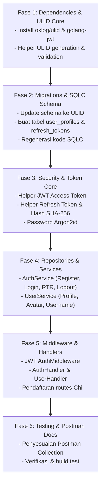

# Personal Go Starter Kit — Architecture & Technical Specification

**Project:** Go REST API Starter Kit  
**Author:** Mochammad Bagas  
**Document Type:** Architecture & Technical Specification  
**Version:** 2.0 (Upgrade to Starter Kit)  
**Date:** November 2026

---

## 1. Overview & Vision

Dokumen ini mendefinisikan arsitektur dan spesifikasi teknis untuk mentransformasikan project `go-crud-api` menjadi **Personal Go Starter Kit** siap pakai untuk pengembangan aplikasi backend di masa depan.

Starter kit ini berfokus pada fondasi backend yang tangguh, aman, dan modular:

- **Identitas Global Berbasis ULID**: Mengganti seluruh integer auto-increment dengan ULID (_Universally Unique Lexicographically Sortable Identifier_) 26-karakter.
- **Autentikasi Modern (JWT + Refresh Token Rotation)**: Menggunakan Access Token stateless dan Refresh Token stateful dengan mekanisme _Refresh Token Rotation (RTR)_ dan _Reuse Detection (Token Family)_ sesuai standar RFC 6749 & OWASP.
- **Delivery Token Hybrid**: Mendukung konsumsi client Web/SPA (via _HTTP-only Cookie_) maupun Mobile/Postman (via _JSON Response Body_).
- **Password Hashing Argon2id**: Standar keamanan tertinggi terkini (RFC 9106).
- **User & Profile Management**: Pengelolaan data akun, profil personal, dan avatar.
- **Modul CRUD Referensi**: Modul `posts` dan `categories` tetap dipertahankan dan disesuaikan ke ULID sebagai blueprint implementasi CRUD.

---

## 2. Standar Identitas: ULID (Crockford Base32)

Seluruh entitas menggunakan **ULID** sebagai Primary Key dan Foreign Key dengan tipe kolom MySQL `CHAR(26)`.

### 2.1. Keunggulan ULID

1. **URL & JSON Safe**: String 26 karakter bebas karakter aneh (`01AN4Z07BY79KA1307SR9X4MV3`), tidak terpengaruh masalah limit presisi integer 53-bit di JavaScript.
2. **Lexicographically Sortable**: 48-bit pertama adalah UNIX timestamp milidetik, sehingga data otomatis terurut secara kronologis (`ORDER BY id DESC`).
3. **Anti Enumeration**: Tidak dapat ditebak urutannya (mencegah scraping/crawling URL id sekuensial).
4. **Decentralized Generation**: Dibuat langsung di sisi aplikasi Go (`github.com/oklog/ulid/v2`) sebelum query dijalankan.

### 2.2. Pemetaan Tipe Data Tabel

| Tabel            | Kolom         | Tipe Data Lama    | Tipe Data Baru (ULID) | Keterangan             |
| ---------------- | ------------- | ----------------- | --------------------- | ---------------------- |
| `users`          | `id`          | `BIGINT UNSIGNED` | `CHAR(26)`            | Primary Key            |
| `user_profiles`  | `user_id`     | _(Baru)_          | `CHAR(26)`            | PK & FK -> `users(id)` |
| `refresh_tokens` | `id`          | _(Baru)_          | `CHAR(26)`            | Primary Key            |
| `refresh_tokens` | `user_id`     | _(Baru)_          | `CHAR(26)`            | FK -> `users(id)`      |
| `categories`     | `id`          | `BIGINT UNSIGNED` | `CHAR(26)`            | Primary Key            |
| `posts`          | `id`          | `BIGINT UNSIGNED` | `CHAR(26)`            | Primary Key            |
| `posts`          | `category_id` | `BIGINT UNSIGNED` | `CHAR(26)`            | FK -> `categories(id)` |
| `post_views`     | `id`          | `BIGINT UNSIGNED` | `CHAR(26)`            | Primary Key            |
| `post_views`     | `post_id`     | `BIGINT UNSIGNED` | `CHAR(26)`            | FK -> `posts(id)`      |

---

## 3. Skema Database (MySQL 8.0+)

### 3.1. Tabel `users`

Menyimpan kredensial inti autentikasi pengguna.

```sql
CREATE TABLE IF NOT EXISTS users (
    id CHAR(26) NOT NULL,
    username VARCHAR(50) NOT NULL,
    email VARCHAR(255) NOT NULL,
    password_hash VARCHAR(255) NOT NULL,
    role ENUM('admin', 'user') NOT NULL DEFAULT 'user',
    status ENUM('active', 'pending_verification', 'suspended') NOT NULL DEFAULT 'active',
    email_verified_at DATETIME NULL,
    created_at DATETIME NOT NULL,
    updated_at DATETIME NOT NULL,
    PRIMARY KEY (id),
    UNIQUE KEY uq_users_username (username),
    UNIQUE KEY uq_users_email (email),
    INDEX idx_users_status (status),
    INDEX idx_users_role (role)
) ENGINE=InnoDB DEFAULT CHARSET=utf8mb4 COLLATE=utf8mb4_0900_ai_ci;
```

### 3.2. Tabel `user_profiles`

Menyimpan informasi profil personal (terpisah dari kredensial auth).

```sql
CREATE TABLE IF NOT EXISTS user_profiles (
    user_id CHAR(26) NOT NULL,
    full_name VARCHAR(100) NOT NULL DEFAULT '',
    bio TEXT NULL,
    phone_number VARCHAR(20) NULL,
    avatar_url VARCHAR(500) NULL,
    created_at DATETIME NOT NULL,
    updated_at DATETIME NOT NULL,
    PRIMARY KEY (user_id),
    CONSTRAINT fk_user_profiles_user FOREIGN KEY (user_id) REFERENCES users(id) ON DELETE CASCADE
) ENGINE=InnoDB DEFAULT CHARSET=utf8mb4 COLLATE=utf8mb4_0900_ai_ci;
```

### 3.3. Tabel `refresh_tokens`

Menyimpan sesi token aktif, hash refresh token, dan pelacakan _token family_ untuk rotasi token.

```sql
CREATE TABLE IF NOT EXISTS refresh_tokens (
    id CHAR(26) NOT NULL,
    user_id CHAR(26) NOT NULL,
    token_hash CHAR(64) NOT NULL,            -- SHA-256 hash dari raw refresh token
    token_family VARCHAR(64) NOT NULL,       -- UUID/Identifier silsilah rotasi token
    is_revoked BOOLEAN NOT NULL DEFAULT FALSE,
    expires_at DATETIME NOT NULL,
    created_at DATETIME NOT NULL,
    user_agent VARCHAR(255) NULL,
    ip_address VARCHAR(45) NULL,
    PRIMARY KEY (id),
    CONSTRAINT fk_refresh_tokens_user FOREIGN KEY (user_id) REFERENCES users(id) ON DELETE CASCADE,
    INDEX idx_refresh_tokens_lookup (token_hash),
    INDEX idx_refresh_tokens_family (token_family),
    INDEX idx_refresh_tokens_expires (expires_at)
) ENGINE=InnoDB DEFAULT CHARSET=utf8mb4 COLLATE=utf8mb4_0900_ai_ci;
```

### 3.4. Tabel `categories`, `posts`, `post_views` (Diperbarui ke ULID)

```sql
CREATE TABLE IF NOT EXISTS categories (
    id CHAR(26) NOT NULL,
    name VARCHAR(100) NOT NULL,
    slug VARCHAR(120) NOT NULL,
    created_at DATETIME NOT NULL,
    updated_at DATETIME NOT NULL,
    PRIMARY KEY (id),
    UNIQUE KEY uq_categories_slug (slug)
) ENGINE=InnoDB DEFAULT CHARSET=utf8mb4 COLLATE=utf8mb4_0900_ai_ci;

CREATE TABLE IF NOT EXISTS posts (
    id CHAR(26) NOT NULL,
    type ENUM('blog', 'article', 'journal') NOT NULL,
    title VARCHAR(255) NOT NULL,
    slug VARCHAR(255) NOT NULL,
    excerpt TEXT NULL,
    content LONGTEXT NOT NULL,
    cover_image VARCHAR(500) NULL,
    category_id CHAR(26) NULL,
    tags JSON NULL,
    meta_title VARCHAR(255) NULL,
    meta_description TEXT NULL,
    is_featured BOOLEAN NOT NULL DEFAULT FALSE,
    status ENUM('draft', 'published') NOT NULL DEFAULT 'draft',
    published_at DATETIME NULL,
    created_at DATETIME NOT NULL,
    updated_at DATETIME NOT NULL,
    PRIMARY KEY (id),
    UNIQUE KEY uq_posts_slug (slug),
    CONSTRAINT fk_posts_category FOREIGN KEY (category_id) REFERENCES categories(id) ON DELETE SET NULL,
    INDEX idx_posts_type_status_published (type, status, published_at),
    INDEX idx_posts_status_published (status, published_at),
    INDEX idx_posts_category_id (category_id)
) ENGINE=InnoDB DEFAULT CHARSET=utf8mb4 COLLATE=utf8mb4_0900_ai_ci;

CREATE TABLE IF NOT EXISTS post_views (
    id CHAR(26) NOT NULL,
    post_id CHAR(26) NOT NULL,
    views BIGINT UNSIGNED NOT NULL DEFAULT 0,
    updated_at DATETIME NOT NULL,
    PRIMARY KEY (id),
    UNIQUE KEY uq_post_views_post_id (post_id),
    CONSTRAINT fk_post_views_post FOREIGN KEY (post_id) REFERENCES posts(id) ON DELETE CASCADE
) ENGINE=InnoDB DEFAULT CHARSET=utf8mb4 COLLATE=utf8mb4_0900_ai_ci;
```

---

## 4. Mekanisme Keamanan & Autentikasi

### 4.1. Access Token (Stateless JWT)

- **Algoritma**: HMAC-SHA256 (HS256).
- **Masa Berlaku**: 15 menit (default, dapat dikonfigurasi via env `JWT_ACCESS_TTL`).
- **Claims**:
  ```json
  {
    "sub": "01ARZ3NDEKTSV4RRFFQ69G5FAV", // user_id (ULID)
    "username": "johndoe",
    "email": "john@example.com",
    "role": "user",
    "exp": 1700000900,
    "iat": 1700000000
  }
  ```

### 4.2. Refresh Token & Refresh Token Rotation (RTR)

- **Token Format**: String acak kriptografis 64 karakter (hex/base64URL).
- **Penyimpanan**: Disimpan di database dalam bentuk **SHA-256 Hash** (`token_hash`) untuk mencegah kebocoran database mengekspos token aktif.
- **Masa Berlaku**: 7 hari (dapat dikonfigurasi via env `JWT_REFRESH_TTL`).
- **Siklus Rotasi (RTR)**:
  1. Client mengirimkan `refresh_token`.
  2. Server meng-hash token dan mencari di tabel `refresh_tokens`.
  3. **Deteksi Pembajakan (Reuse Detection)**:
     - Jika token yang dikirim statusnya `is_revoked = TRUE`, ini berarti token lama yang sudah dirotasi dicoba digunakan kembali (potensi serangan pencurian token!).
     - **Tindakan**: Server langsung membatalkan seluruh token dalam `token_family` yang sama (`UPDATE refresh_tokens SET is_revoked = TRUE WHERE token_family = ?`). Pengguna otomatis ter-logout dari sesi terkait.
  4. Jika token valid dan belum kedaluwarsa:
     - Tandai token saat ini sebagai `is_revoked = TRUE`.
     - Buat refresh token baru dengan `token_family` yang sama.
     - Simpan hash token baru ke database.
     - Terbitkan Access Token baru dan Refresh Token baru kepada client.

### 4.3. Delivery Token Hybrid

1. **JSON Body**:
   ```json
   {
     "access_token": "eyJhbGciOi...",
     "refresh_token": "d7a8f9...",
     "token_type": "Bearer",
     "expires_in": 900
   }
   ```
2. **HTTP-only Cookie**:
   - Nama Cookie: `refresh_token`
   - Flags: `HttpOnly = true`, `Secure = (env == "production")`, `SameSite = Lax`, `Path = /api/v1/auth`

---

## 5. Rincian Endpoint API

### 5.1. Authentication (`/api/v1/auth`)

| Method | Endpoint                       | Auth            | Deskripsi                                                        |
| ------ | ------------------------------ | --------------- | ---------------------------------------------------------------- |
| `POST` | `/api/v1/auth/register`        | Public          | Registrasi akun baru (username, email, password).                |
| `POST` | `/api/v1/auth/login`           | Public          | Login akun. Mengembalikan token hybrid. Dilindungi rate limiter. |
| `POST` | `/api/v1/auth/refresh`         | Public / Cookie | Memperoleh access token baru dengan mekanisme RTR.               |
| `POST` | `/api/v1/auth/logout`          | Protected       | Mencabut refresh token dan menghapus cookie.                     |
| `POST` | `/api/v1/auth/change-password` | Protected       | Mengganti password & mencabut sesi token lainnya.                |

### 5.2. User Management (`/api/v1/users`)

| Method   | Endpoint                 | Auth      | Deskripsi                                            |
| -------- | ------------------------ | --------- | ---------------------------------------------------- |
| `GET`    | `/api/v1/users/me`       | Protected | Mengambil informasi akun dan profil user yang login. |
| `PUT`    | `/api/v1/users/profile`  | Protected | Mengubah data profil (full_name, bio, phone_number). |
| `POST`   | `/api/v1/users/avatar`   | Protected | Mengunggah file gambar avatar (multipart/form-data). |
| `DELETE` | `/api/v1/users/avatar`   | Protected | Menghapus avatar dan kembali ke default.             |
| `PUT`    | `/api/v1/users/username` | Protected | Mengubah username (validasi unik & format).          |
| `GET`    | `/api/v1/users/status`   | Protected | Melihat status akun dan status verifikasi.           |

### 5.3. Content Management (`/api/v1/posts` & `/api/v1/categories`)

- Tetap dipertahankan dengan penyesuaian ID ke **ULID**.
- Endpoint admin diproteksi dengan middleware JWT role check (hanya `role = 'admin'`).

---

## 6. Rencana Implementasi Bertahap



### Detail Langkah:

1. **Fase 1 (Dependencies & Helper ULID)**:
   - Tambahkan package `github.com/oklog/ulid/v2` dan `github.com/golang-jwt/jwt/v5`.
   - Buat helper generator ULID di `internal/utils/ulid.go`.
2. **Fase 2 (Database & SQLC)**:
   - Perbarui file migration SQL dengan skema ULID.
   - Buat query SQLC baru untuk `users`, `user_profiles`, dan `refresh_tokens`.
   - Jalankan `sqlc generate`.
3. **Fase 3 (JWT & Token Logic)**:
   - Implementasikan pembuatan dan verifikasi JWT di `internal/utils/jwt.go`.
   - Implementasikan hashing SHA-256 untuk refresh token.
4. **Fase 4 (Service Layer)**:
   - Implementasikan logika bisnis auth (registrasi, login, reuse detection, logout, change password).
   - Implementasikan logika user profile & avatar.
5. **Fase 5 (Routing & Middleware)**:
   - Refactor `AuthMiddleware` untuk membaca Bearer JWT token.
   - Sambungkan handler ke route router `chi`.
6. **Fase 6 (Finalisasi)**:
   - Eksekusi `go test ./...` dan `go build`.
   - Perbarui dokumentasi API & Postman Collection.
