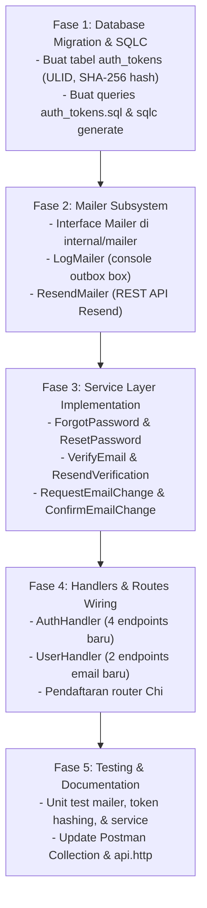

# Personal Go Starter Kit — Architecture & Technical Specification

**Project:** Go REST API Starter Kit  
**Author:** Mochammad Bagas  
**Document Type:** Architecture & Technical Specification  
**Version:** 2.1 (Security Expansion: Password Reset, Email Verification & Pluggable Mailer)  
**Date:** November 2026

---

## 1. Overview & Vision

Dokumen ini mendefinisikan arsitektur dan spesifikasi teknis untuk mentransformasikan project `go-crud-api` menjadi **Personal Go Starter Kit** siap pakai untuk pengembangan aplikasi backend di masa depan.

Starter kit ini berfokus pada fondasi backend yang tangguh, aman, modular, dan berstandar industri:

- **Identitas Global Berbasis ULID**: Mengganti seluruh integer auto-increment dengan ULID (_Universally Unique Lexicographically Sortable Identifier_) 26-karakter.
- **Autentikasi Modern (JWT + Refresh Token Rotation)**: Menggunakan Access Token stateless dan Refresh Token stateful dengan mekanisme _Refresh Token Rotation (RTR)_ dan _Reuse Detection (Token Family)_ sesuai standar RFC 6749 & OWASP.
- **Delivery Token Hybrid**: Mendukung konsumsi client Web/SPA (via _HTTP-only Cookie_) maupun Mobile/Postman (via _JSON Response Body_).
- **Password Hashing Argon2id**: Standar keamanan tertinggi terkini (RFC 9106).
- **User & Profile Management**: Pengelolaan data akun, profil personal, avatar, dan alur pembaruan email dengan verifikasi.
- **Pemulihan Akun & Verifikasi Email (Driver-based Mailer)**:
  - **Forgot & Reset Password**: Pemulihan kata sandi dengan token acak aman (hash SHA-256) dan mitigasi _anti user-enumeration_.
  - **Email Verification**: Verifikasi alamat email akun baru dan dukungan pengiriman ulang (_resend verification_).
  - **Email Change Verification**: Pembaruan email utama dengan verifikasi ke email tujuan baru.
  - **Pluggable Mailer Architecture**: Mendukung **`LogMailer`** (bawaan lokal tanpa akun/setup, mencetak email ke console) dan **`ResendMailer`** (_production plug-and-play_ via API Key Resend).
- **Modul CRUD Referensi**: Modul `posts` dan `categories` tetap dipertahankan dan disesuaikan ke ULID sebagai blueprint implementasi CRUD.

---

## 2. Standar Identitas: ULID (Crockford Base32)

Seluruh entitas menggunakan **ULID** sebagai Primary Key dan Foreign Key dengan tipe kolom MySQL `CHAR(26)`.

### 2.1. Keunggulan ULID

1. **URL & JSON Safe**: String 26 karakter bebas karakter aneh (`01AN4Z07BY79KA1307SR9X4MV3`), tidak terpengaruh masalah limit presisi integer 53-bit di JavaScript.
2. **Lexicographically Sortable**: 48-bit pertama adalah UNIX timestamp milidetik, sehingga data otomatis terurut secara kronologis (`ORDER BY id DESC`).
3. **Anti Enumeration**: Tidak dapat ditebak urutannya (mencegah scraping/crawling URL id sekuensial).
4. **Decentralized Generation**: Dibuat langsung di sisi aplikasi Go (`github.com/oklog/ulid/v2`) sebelum query dijalankan.

### 2.2. Pemetaan Tipe Data Tabel

| Tabel            | Kolom               | Tipe Data  | Keterangan                                 |
| :--------------- | :------------------ | :--------- | :----------------------------------------- |
| `users`          | `id`                | `CHAR(26)` | Primary Key                                |
| `user_profiles`  | `user_id`           | `CHAR(26)` | PK & FK -> `users(id)`                     |
| `refresh_tokens` | `id`, `user_id`     | `CHAR(26)` | PK & FK -> `users(id)`                     |
| `auth_tokens`    | `id`, `user_id`     | `CHAR(26)` | PK & FK -> `users(id)` (Token Reset/Verif) |
| `categories`     | `id`                | `CHAR(26)` | Primary Key                                |
| `posts`          | `id`, `category_id` | `CHAR(26)` | PK & FK -> `categories(id)`                |
| `post_views`     | `id`, `post_id`     | `CHAR(26)` | PK & FK -> `posts(id)`                     |

---

## 3. Skema Database (MySQL 8.0+)

### 3.1. Tabel `users`

```sql
CREATE TABLE IF NOT EXISTS users (
    id CHAR(26) NOT NULL,
    username VARCHAR(50) NOT NULL,
    email VARCHAR(255) NOT NULL,
    password_hash VARCHAR(255) NOT NULL,
    role ENUM('admin', 'user') NOT NULL DEFAULT 'user',
    status ENUM('active', 'pending_verification', 'suspended') NOT NULL DEFAULT 'active',
    email_verified_at DATETIME NULL,
    created_at DATETIME NOT NULL,
    updated_at DATETIME NOT NULL,
    PRIMARY KEY (id),
    UNIQUE KEY uq_users_username (username),
    UNIQUE KEY uq_users_email (email),
    INDEX idx_users_status (status),
    INDEX idx_users_role (role)
) ENGINE=InnoDB DEFAULT CHARSET=utf8mb4 COLLATE=utf8mb4_0900_ai_ci;
```

### 3.2. Tabel `user_profiles`

```sql
CREATE TABLE IF NOT EXISTS user_profiles (
    user_id CHAR(26) NOT NULL,
    full_name VARCHAR(100) NOT NULL DEFAULT '',
    bio TEXT NULL,
    phone_number VARCHAR(20) NULL,
    avatar_url VARCHAR(500) NULL,
    created_at DATETIME NOT NULL,
    updated_at DATETIME NOT NULL,
    PRIMARY KEY (user_id),
    CONSTRAINT fk_user_profiles_user FOREIGN KEY (user_id) REFERENCES users(id) ON DELETE CASCADE
) ENGINE=InnoDB DEFAULT CHARSET=utf8mb4 COLLATE=utf8mb4_0900_ai_ci;
```

### 3.3. Tabel `refresh_tokens`

```sql
CREATE TABLE IF NOT EXISTS refresh_tokens (
    id CHAR(26) NOT NULL,
    user_id CHAR(26) NOT NULL,
    token_hash CHAR(64) NOT NULL,            -- SHA-256 hash dari raw refresh token
    token_family VARCHAR(64) NOT NULL,       -- Identifier silsilah rotasi token
    is_revoked BOOLEAN NOT NULL DEFAULT FALSE,
    expires_at DATETIME NOT NULL,
    created_at DATETIME NOT NULL,
    user_agent VARCHAR(255) NULL,
    ip_address VARCHAR(45) NULL,
    PRIMARY KEY (id),
    CONSTRAINT fk_refresh_tokens_user FOREIGN KEY (user_id) REFERENCES users(id) ON DELETE CASCADE,
    INDEX idx_refresh_tokens_lookup (token_hash),
    INDEX idx_refresh_tokens_family (token_family),
    INDEX idx_refresh_tokens_expires (expires_at)
) ENGINE=InnoDB DEFAULT CHARSET=utf8mb4 COLLATE=utf8mb4_0900_ai_ci;
```

### 3.4. Tabel `auth_tokens` (Terpadu: Reset Password, Verifikasi Email, & Ubah Email)

Menyimpan token verifikasi satu kali pakai (_single-use tokens_):

```sql
CREATE TABLE IF NOT EXISTS auth_tokens (
    id CHAR(26) NOT NULL,
    user_id CHAR(26) NOT NULL,
    token_hash CHAR(64) NOT NULL,            -- SHA-256 hash dari token mentah
    token_type ENUM('password_reset', 'email_verification', 'email_change') NOT NULL,
    payload VARCHAR(255) NULL,               -- Menyimpan alamat new_email (khusus email_change)
    is_used BOOLEAN NOT NULL DEFAULT FALSE,
    expires_at DATETIME NOT NULL,
    created_at DATETIME NOT NULL,
    PRIMARY KEY (id),
    CONSTRAINT fk_auth_tokens_user FOREIGN KEY (user_id) REFERENCES users(id) ON DELETE CASCADE,
    INDEX idx_auth_tokens_lookup (token_hash, token_type),
    INDEX idx_auth_tokens_user (user_id),
    INDEX idx_auth_tokens_expires (expires_at)
) ENGINE=InnoDB DEFAULT CHARSET=utf8mb4 COLLATE=utf8mb4_0900_ai_ci;
```

### 3.5. Tabel Konten (`categories`, `posts`, `post_views`)

```sql
CREATE TABLE IF NOT EXISTS categories (
    id CHAR(26) NOT NULL,
    name VARCHAR(100) NOT NULL,
    slug VARCHAR(120) NOT NULL,
    created_at DATETIME NOT NULL,
    updated_at DATETIME NOT NULL,
    PRIMARY KEY (id),
    UNIQUE KEY uq_categories_slug (slug)
) ENGINE=InnoDB DEFAULT CHARSET=utf8mb4 COLLATE=utf8mb4_0900_ai_ci;

CREATE TABLE IF NOT EXISTS posts (
    id CHAR(26) NOT NULL,
    type ENUM('blog', 'article', 'journal') NOT NULL,
    title VARCHAR(255) NOT NULL,
    slug VARCHAR(255) NOT NULL,
    excerpt TEXT NULL,
    content LONGTEXT NOT NULL,
    cover_image VARCHAR(500) NULL,
    category_id CHAR(26) NULL,
    tags JSON NULL,
    meta_title VARCHAR(255) NULL,
    meta_description TEXT NULL,
    is_featured BOOLEAN NOT NULL DEFAULT FALSE,
    status ENUM('draft', 'published') NOT NULL DEFAULT 'draft',
    published_at DATETIME NULL,
    created_at DATETIME NOT NULL,
    updated_at DATETIME NOT NULL,
    PRIMARY KEY (id),
    UNIQUE KEY uq_posts_slug (slug),
    CONSTRAINT fk_posts_category FOREIGN KEY (category_id) REFERENCES categories(id) ON DELETE SET NULL,
    INDEX idx_posts_type_status_published (type, status, published_at),
    INDEX idx_posts_status_published (status, published_at),
    INDEX idx_posts_category_id (category_id)
) ENGINE=InnoDB DEFAULT CHARSET=utf8mb4 COLLATE=utf8mb4_0900_ai_ci;

CREATE TABLE IF NOT EXISTS post_views (
    id CHAR(26) NOT NULL,
    post_id CHAR(26) NOT NULL,
    views BIGINT UNSIGNED NOT NULL DEFAULT 0,
    updated_at DATETIME NOT NULL,
    PRIMARY KEY (id),
    UNIQUE KEY uq_post_views_post_id (post_id),
    CONSTRAINT fk_post_views_post FOREIGN KEY (post_id) REFERENCES posts(id) ON DELETE CASCADE
) ENGINE=InnoDB DEFAULT CHARSET=utf8mb4 COLLATE=utf8mb4_0900_ai_ci;
```

---

## 4. Mekanisme Keamanan & Alur Autentikasi

### 4.1. Access Token (Stateless JWT)

- Algoritma: HMAC-SHA256 (`HS256`).
- Masa berlaku: 15 menit (konfigurasi via `JWT_ACCESS_TTL_MINUTES`).
- Claims: `sub` (ULID), `user_id`, `username`, `email`, `role`, `exp`, `iat`.

### 4.2. Refresh Token Rotation (RTR)

- Raw Token: String acak kriptografis 64 karakter (`crypto/rand`).
- Penyimpanan: Disimpan hanya dalam bentuk hash SHA-256 (`token_hash`).
- Deteksi Pembajakan (_Reuse Detection_): Menggunakan token yang sudah di-revoke akan membatalkan seluruh token dalam `token_family` terkait.

### 4.3. Pluggable Mailer Architecture (Adapter Pattern)

Interface terpadu di `internal/mailer`:

```go
type Mailer interface {
    SendResetPasswordEmail(ctx context.Context, toEmail, resetLink string) error
    SendVerificationEmail(ctx context.Context, toEmail, verifyLink string) error
    SendEmailChangeEmail(ctx context.Context, toNewEmail, confirmLink string) error
}
```

1. **`LogMailer` (Bawaan Development)**:
   - Aktif jika `MAILER_DRIVER=log` (default).
   - Tanpa akun eksternal dan tanpa biaya.
   - Mencetak kotak outbox email rapi ke log terminal lengkap dengan link dan token agar dapat langsung disalin ke Postman.
2. **`ResendMailer` (Production Plug-and-Play)**:
   - Aktif jika `MAILER_DRIVER=resend`.
   - Menggunakan Resend REST API (HTTPS port 443).
   - Mengirim email HTML responsif ke inbox email penerima.

#### Tutorial Konfigurasi Resend:

1. Buat akun di [resend.com](https://resend.com).
2. Di dashboard Resend, buat API key baru di menu **API Keys** (`re_...`).
3. Untuk pengujian awal tanpa custom domain, gunakan `MAIL_FROM=Go Starter Kit <onboarding@resend.dev>`.
4. Untuk produksi, daftarkan domain Anda di menu **Domains** dan verifikasi DNS record (DKIM & SPF).
5. Pada `.env` (atau `.env.docker`), isi:
   ```ini
   MAILER_DRIVER=resend
   RESEND_API_KEY=re_xxxxxxxxxxxxxxxxxxxx
   MAIL_FROM=App Name <no-reply@yourdomain.com>
   FRONTEND_URL=https://your-frontend-app.com
   ```
6. Restart aplikasi. Sistem secara otomatis beralih menggunakan `ResendMailer`.

### 4.4. Alur Forgot & Reset Password

1. **Forgot Password**:
   - Menerima `email`.
   - **Anti User-Enumeration**: Jika email tidak ditemukan, server tetap mengembalikan respon status `200 OK` (_"Jika email terdaftar, tautan pemulihan kata sandi telah dikirim"_).
   - Jika email terdaftar: Buat token acak (32 bytes), simpan hash SHA-256 ke `auth_tokens` (tipe: `password_reset`, TTL: 15 menit), kirim link reset via Mailer.
2. **Reset Password**:
   - Menerima `token` dan `new_password`.
   - Validasi hash token, masa berlaku, dan pastikan `is_used = FALSE`.
   - Update password pengguna di tabel `users` dengan hash Argon2id baru.
   - Tandai token sebagai `is_used = TRUE`.
   - **Keamanan Sesi**: Otomatis mencabut seluruh refresh token aktif pengguna (`RevokeAllUserTokens`) agar seluruh sesi perangkat lain ter-logout.

### 4.5. Alur Verifikasi Email Pendaftaran

1. Saat registrasi, token verifikasi (tipe: `email_verification`, TTL: 24 jam) dibuat dan dikirimkan via Mailer.
2. Pengguna memanggil `POST /api/v1/auth/verify-email` membawa token.
3. Server memvalidasi token, menandai `email_verified_at = NOW()` dan `status = 'active'`.
4. Endpoint `POST /api/v1/auth/resend-verification` tersedia dengan rate limiter untuk mengirim ulang link verifikasi jika token kedaluwarsa.

### 4.6. Alur Ubah Email (Email Change Verification)

1. Pengguna login memanggil `POST /api/v1/users/email/request-change` membawa `new_email` dan `password` saat ini.
2. Server memvalidasi password lama dan memastikan `new_email` belum digunakan pengguna lain.
3. Server membuat token (tipe: `email_change`, TTL: 1 jam) dengan field `payload` diisi alamat `new_email`.
4. Server mengirim link verifikasi ke **alamat `new_email`**.
5. Pengguna mengonfirmasi melalui `POST /api/v1/users/email/confirm-change` dengan token.
6. Server memvalidasi token, mengupdate `users.email = payload`, dan menandai `email_verified_at = NOW()`.

---

## 5. Rincian Endpoint API

### 5.1. Authentication (`/api/v1/auth`)

| Method         | Endpoint                           | Auth                  | Deskripsi                                             |
| :------------- | :--------------------------------- | :-------------------- | :---------------------------------------------------- |
| `POST`         | `/api/v1/auth/register`            | Public (Rate Limited) | Registrasi akun baru & kirim email verifikasi.        |
| `POST`         | `/api/v1/auth/login`               | Public (Rate Limited) | Login akun, cek status aktif, return hybrid tokens.   |
| `POST`         | `/api/v1/auth/refresh`             | Public / Cookie       | Rotasi access & refresh token (RTR).                  |
| `POST`         | `/api/v1/auth/logout`              | Protected (Bearer)    | Mencabut refresh token dan menghapus cookie.          |
| `POST`         | `/api/v1/auth/change-password`     | Protected (Bearer)    | Mengganti password akun dan mencabut sesi lainnya.    |
| `POST`         | `/api/v1/auth/forgot-password`     | Public (Rate Limited) | Minta link reset password (anti user-enumeration).    |
| `POST`         | `/api/v1/auth/reset-password`      | Public (Rate Limited) | Reset password menggunakan token reset.               |
| `GET` / `POST` | `/api/v1/auth/verify-email`        | Public                | Konfirmasi verifikasi email (link query / JSON body). |
| `POST`         | `/api/v1/auth/resend-verification` | Public (Rate Limited) | Kirim ulang email verifikasi akun baru.               |

### 5.2. User Management (`/api/v1/users`)

| Method         | Endpoint                             | Auth               | Deskripsi                                            |
| :------------- | :----------------------------------- | :----------------- | :--------------------------------------------------- |
| `GET`          | `/api/v1/users/me`                   | Protected (Bearer) | Ambil profil akun & personal pengguna login.         |
| `PUT`          | `/api/v1/users/profile`              | Protected (Bearer) | Update nama, bio, dan nomor telepon.                 |
| `POST`         | `/api/v1/users/avatar`               | Protected (Bearer) | Upload foto avatar (JPG/PNG/WEBP maks 5MB).          |
| `DELETE`       | `/api/v1/users/avatar`               | Protected (Bearer) | Hapus avatar pengguna.                               |
| `PUT`          | `/api/v1/users/username`             | Protected (Bearer) | Ganti username (validasi alfanumerik & unik).        |
| `GET`          | `/api/v1/users/status`               | Protected (Bearer) | Melihat status akun dan status verifikasi email.     |
| `POST`         | `/api/v1/users/email/request-change` | Protected (Bearer) | Request ganti email (wajib password konfirmasi).     |
| `GET` / `POST` | `/api/v1/users/email/confirm-change` | Public             | Konfirmasi perubahan email (link query / JSON body). |

### 5.3. Content Management (`/api/v1/posts` & `/api/v1/categories`)

- CRUD postingan dan kategori tetap dipertahankan dengan ID berbasis ULID.

---

## 6. Rencana Implementasi Bertahap


