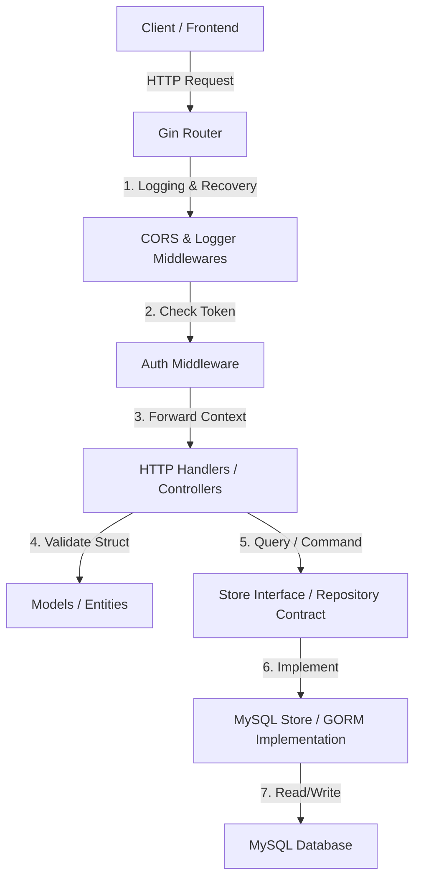
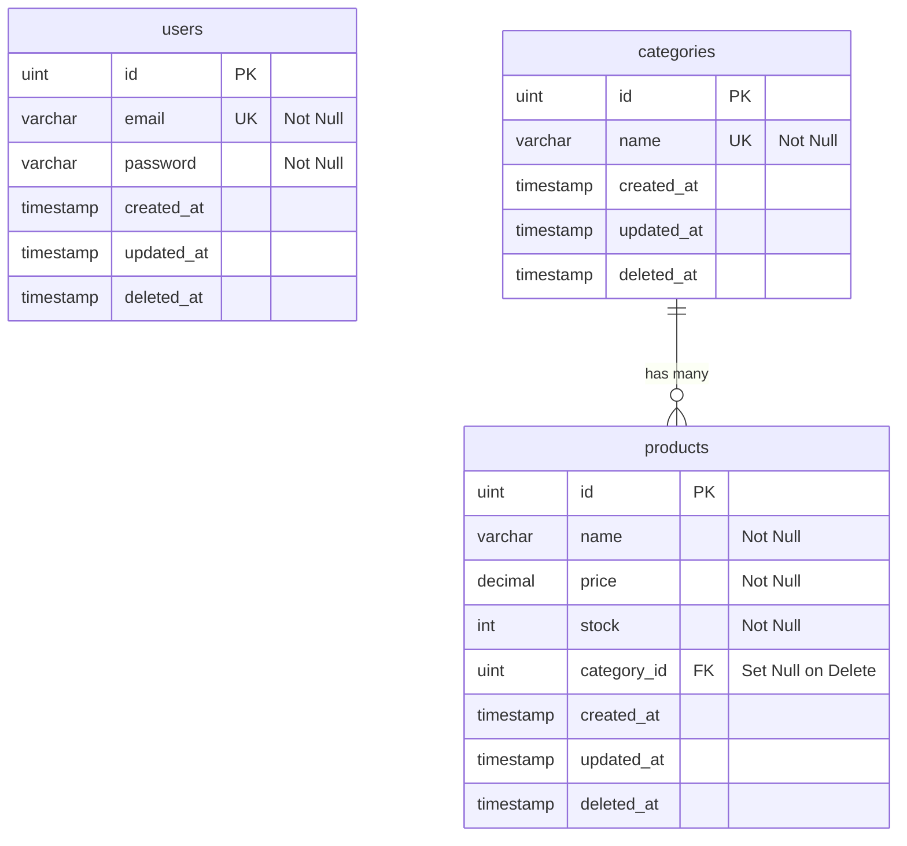

# Technical Specification Document (TSD) & API Specifications

Dokumen ini memuat spesifikasi teknis lengkap, desain arsitektur, skema database, dan kontrak API untuk proyek **Go CRUD API (Product & Auth)**. Dokumen ini dirancang sebagai panduan komprehensif bagi frontend developer untuk berintegrasi, serta sebagai cetak biru (blueprint) bagi backend developer untuk mereplikasi proyek dengan spesifikasi serupa di masa depan.

---

## 1. System Architecture & Request Lifecycle

Aplikasi ini menggunakan pola **Layered Architecture (Clean Architecture sederhana)** dengan menerapkan **Repository Pattern**. Hal ini memisahkan tanggung jawab antara *HTTP Delivery layer*, *Business Logic/Model layer*, dan *Data Access layer*.

### Diagram Arsitektur Hubungan Komponen



### Request Lifecycle
1. **Client** mengirimkan HTTP Request (misal: `POST /products`).
2. **Gin Router** menangkap request dan mengarahkannya melalui rantai middleware:
   - `CORS`: Menambahkan header CORS agar aman diakses dari browser frontend.
   - `Logger` & `Recovery`: Mencatat latensi request ke terminal dan menangkap error fatal agar tidak crash.
   - `AuthMiddleware` (jika endpoint terproteksi): Mengekstrak token JWT dari header `Authorization: Bearer <TOKEN>`, memverifikasinya, dan menyisipkan `user_id` ke dalam request context.
3. **Handlers (Controller)** menerima kontrol, membaca data input JSON menggunakan `c.ShouldBindJSON()`, lalu melakukan validasi data menggunakan metode `.Validate()` milik Model.
4. Jika valid, Handler memanggil **Store Interface** (kontrak repositori).
5. **MySQLStore** (implementasi GORM) berkomunikasi dengan **MySQL Database** menggunakan koneksi pool yang efisien.
6. Data dikembalikan ke Handler, kemudian dikonversi menjadi format JSON standar untuk dikirim kembali ke **Client** beserta status code yang tepat.

---

## 2. Database Schema & Entity Relationship Diagram (ERD)

Database proyek ini terdiri dari tiga tabel utama: `users`, `categories`, dan `products`. Hubungan antar tabel digambarkan menggunakan diagram di bawah ini.

### Entity Relationship Diagram (Mermaid)



### Spesifikasi Tabel Detail

#### Tabel 1: `users`
Menyimpan kredensial akun pengguna untuk proses login berbasis JWT.
- **`id`** (`INT UNSIGNED`, Primary Key, Auto Increment)
- **`email`** (`VARCHAR(255)`, Unique Index, Not Null)
- **`password`** (`VARCHAR(255)`, Not Null): Di-hash menggunakan algoritma **Bcrypt** di level aplikasi sebelum disimpan.
- **`created_at`** (`TIMESTAMP`): Tanggal akun dibuat.
- **`updated_at`** (`TIMESTAMP`): Tanggal terakhir akun di-update.
- **`deleted_at`** (`TIMESTAMP`, Index): Timestamp soft delete GORM.

#### Tabel 2: `categories`
Menyimpan nama-nama kategori produk.
- **`id`** (`INT UNSIGNED`, Primary Key, Auto Increment)
- **`name`** (`VARCHAR(255)`, Unique Index, Not Null)
- **`created_at`**, **`updated_at`**, **`deleted_at`** (`TIMESTAMP`): Field standard audit GORM.

#### Tabel 3: `products`
Menyimpan data produk yang dijual.
- **`id`** (`INT UNSIGNED`, Primary Key, Auto Increment)
- **`name`** (`VARCHAR(255)`, Not Null)
- **`price`** (`DECIMAL(10,2)`, Not Null)
- **`stock`** (`INT`, Not Null)
- **`category_id`** (`INT UNSIGNED`, Foreign Key): Berelasi ke `categories.id` dengan aturan constraint `ON UPDATE CASCADE ON DELETE SET NULL`.
- **`created_at`**, **`updated_at`**, **`deleted_at`** (`TIMESTAMP`)

---

## 3. API Contract Specifications (Backend-Frontend Integration)

Semua endpoint API mengembalikan data dalam format JSON. Format respon diseragamkan untuk mempermudah pemrosesan data di sisi frontend.

### Standard Response Formats

#### Respon Sukses (Contoh)
```json
{
  "id": 1,
  "name": "Barang",
  ...
}
```

#### Respon Error (Standard)
```json
{
  "error": "Pesan deskripsi kesalahan"
}
```

---

### Endpoint Registrasi & Login

#### 1. Register User Baru
Pendaftaran akun baru dengan validasi format dasar email dan panjang password.
- **Method & URL**: `POST /register`
- **Autentikasi**: Publik (Tidak Butuh Token)
- **Request Body**:
  ```json
  {
    "email": "string (wajib, email format)",
    "password": "string (wajib, minimal 6 karakter)"
  }
  ```
- **Responses**:
  - `201 Created` (Sukses):
    ```json
    {
      "id": 1,
      "email": "user@gmail.com",
      "created_at": "2026-06-28T12:00:00Z",
      "updated_at": "2026-06-28T12:00:00Z"
    }
    ```
  - `400 Bad Request` (Validasi Gagal): `{"error": "password minimal harus 6 karakter"}`
  - `409 Conflict` (Email Duplikat): `{"error": "email sudah terdaftar"}`

#### 2. Login User
Verifikasi password bcrypt dan dapatkan token akses JWT.
- **Method & URL**: `POST /login`
- **Autentikasi**: Publik
- **Request Body**:
  ```json
  {
    "email": "string (wajib)",
    "password": "string (wajib)"
  }
  ```
- **Responses**:
  - `200 OK` (Sukses):
    ```json
    {
      "token": "eyJhbGciOiJIUzI1NiIsIn..."
    }
    ```
  - `401 Unauthorized` (Salah Kredensial): `{"error": "email atau password salah"}`

#### 3. Cek Profil Saya
Mendapatkan profil pengguna yang sedang login berdasarkan verifikasi token JWT.
- **Method & URL**: `GET /me`
- **Autentikasi**: **JWT Bearer Token** (Wajib menyertakan header `Authorization: Bearer <TOKEN>`)
- **Responses**:
  - `200 OK` (Sukses):
    ```json
    {
      "id": 1,
      "email": "user@gmail.com",
      "created_at": "2026-06-28T12:00:00Z",
      "updated_at": "2026-06-28T12:00:00Z"
    }
    ```
  - `401 Unauthorized` (Token Salah/Kadaluarsa): `{"error": "token tidak valid atau telah kadaluarsa"}`

---

### Endpoint Products CRUD

#### 1. Ambil Semua Produk
Mendapatkan daftar seluruh produk yang aktif beserta relasi kategorinya.
- **Method & URL**: `GET /products`
- **Autentikasi**: Publik
- **Response Contoh (200 OK)**:
  ```json
  [
    {
      "id": 1,
      "name": "Keyboard Mekanikal",
      "price": 450000,
      "stock": 12,
      "category_id": 2,
      "category": {
        "id": 2,
        "name": "Aksesoris",
        "created_at": "2026-06-28T06:23:00Z",
        "updated_at": "2026-06-28T06:23:00Z"
      },
      "created_at": "2026-06-28T06:23:00Z",
      "updated_at": "2026-06-28T06:23:00Z"
    }
  ]
  ```

#### 2. Detail Produk
Mendapatkan detail satu produk berdasarkan ID.
- **Method & URL**: `GET /products/:id`
- **Autentikasi**: Publik
- **Responses**:
  - `200 OK` (Sukses): Format sama seperti objek di atas.
  - `404 Not Found` (Tidak Ditemukan): `{"error": "produk tidak ditemukan"}`

#### 3. Tambah Produk Baru
Memasukkan produk baru ke database.
- **Method & URL**: `POST /products`
- **Autentikasi**: **JWT Bearer Token**
- **Request Body**:
  ```json
  {
    "name": "string (wajib, tidak boleh kosong)",
    "price": "number (wajib, >= 0)",
    "stock": "integer (wajib, >= 0)",
    "category_id": "integer (wajib, ID kategori terdaftar)"
  }
  ```
- **Responses**:
  - `201 Created` (Sukses): Mengembalikan objek produk baru lengkap dengan objek `category`.
  - `400 Bad Request` (Validasi Gagal / JSON Salah): `{"error": "price tidak boleh kurang dari 0"}`
  - `401 Unauthorized` (Tanpa Token): `{"error": "header Authorization wajib disertakan"}`

#### 4. Ubah Data Produk
Melakukan perubahan data produk secara menyeluruh (full update).
- **Method & URL**: `PUT /products/:id`
- **Autentikasi**: **JWT Bearer Token**
- **Request Body**: Sama seperti `POST /products`.
- **Responses**:
  - `200 OK` (Sukses): Mengembalikan objek produk yang telah di-update.
  - `404 Not Found`: `{"error": "produk tidak ditemukan"}`

#### 5. Hapus Produk
Menghapus produk menggunakan soft delete.
- **Method & URL**: `DELETE /products/:id`
- **Autentikasi**: **JWT Bearer Token**
- **Responses**:
  - `204 No Content` (Sukses): *Tidak mengembalikan body data.*
  - `404 Not Found`: `{"error": "produk tidak ditemukan"}`

---

## 4. Technical Design Decisions (TSD)

Dalam perancangan proyek ini, beberapa keputusan teknologi diambil berdasarkan pertimbangan efisiensi dan kemudahan pengembangan jangka panjang:

### A. Penggunaan Gin Gonic Framework
- **Alasan**: Gin menawarkan keseimbangan terbaik di Go antara kecepatan (menggunakan HttpRouter yang berbasis radix tree) dan kemudahan penggunaan. Fitur *routing parameter* (seperti `/:id`) mempermudah pengembangan API yang bersih tanpa harus mengunduh router pihak ketiga lainnya secara manual.
- **Middlewares**: Gin mempermudah pemisahan tanggung jawab *logging* dan *panic recovery* dengan middleware bawaan sehingga handler kita tetap bersih dari kode penanganan error server global.

### B. Decoupled Store (Repository Pattern)
- **Alasan**: Handler (Controller) tidak mengetahui bagaimana database diakses. Handler hanya berinteraksi melalui interface `Store`.
- **Manfaat**: Mempermudah pengujian unit (unit testing) karena kita bisa membuat *mock repository* ([InMemoryStore](file:///c:/Users/mmdbc/Development/Personal/Sandbox/Golang/go-crud-api/internal/store/store.go#L29-L35)) tanpa harus menghubungkan koneksi database nyata saat pengujian otomatis berjalan di CI/CD.

### C. Database Connection Pooling
- **Alasan**: Untuk mencegah kebocoran koneksi (*connection leaks*) di bawah beban tinggi, kami mengonfigurasi pool koneksi MySQL pada startup di [main.go](file:///c:/Users/mmdbc/Development/Personal/Sandbox/Golang/go-crud-api/cmd/server/main.go#L55-L60):
  ```go
  sqlDB.SetMaxIdleConns(10)     // Jumlah maksimal koneksi idle yang disimpan
  sqlDB.SetMaxOpenConns(100)    // Batas atas jumlah koneksi yang dibuka serentak
  sqlDB.SetConnMaxLifetime(time.Hour) // Umur maksimal satu koneksi sebelum di-recycle
  ```

### D. Penanganan Graceful Shutdown
- **Alasan**: Di lingkungan produksi, server tidak boleh mati mendadak saat sedang memproses transaksi pengguna.
- **Implementasi**: Kita menjalankan server HTTP di dalam goroutine terpisah dan memblokir proses utama menggunakan saluran (*channel*) yang mendengarkan sinyal terminasi OS (`SIGINT`, `SIGTERM`). Ketika sinyal diterima, aplikasi diberi waktu 10 detik untuk menyelesaikan request HTTP yang sedang berjalan sebelum dimatikan total.

---

## 5. Panduan Duplikasi Proyek (Template Pembuatan Ulang)

Untuk membangun proyek baru dengan spesifikasi teknologi yang sama dari nol, ikuti langkah-langkah terstruktur berikut:

### Langkah 1: Inisialisasi Proyek
1. Buat folder baru dan inisialisasi modul Go:
   ```bash
   mkdir nama-proyek
   cd nama-proyek
   go mod init nama-proyek
   ```

### Langkah 2: Inisialisasi Dependensi Inti
Unduh library utama yang kita gunakan:
```bash
# Framework Gin
go get github.com/gin-gonic/gin

# GORM ORM & Driver MySQL
go get gorm.io/gorm gorm.io/driver/mysql

# Pembacaan file .env & hashing bcrypt & token JWT
go get github.com/joho/godotenv golang.org/x/crypto/bcrypt github.com/golang-jwt/jwt/v5
```

### Langkah 3: Siapkan Struktur Folder Standar
Buat struktur direktori berikut di root folder Anda:
```bash
mkdir -p cmd/server docs internal/config internal/database internal/handlers internal/middleware internal/models internal/routes internal/store
```

### Langkah 4: Tulis Kode Konfigurasi & Model
1. Buat file `.env` berisi detail koneksi database dan `JWT_SECRET`.
2. Tulis file `internal/config/config.go` untuk memuat variabel lingkungan tersebut.
3. Tulis struct entitas model di dalam `internal/models/` (misal: `user.go`, `product.go`, `category.go`). Manfaatkan GORM hooks `BeforeSave` untuk proses enkripsi password otomatis.

### Langkah 5: Desain Repositori (Store) & Database Layer
1. Definisikan kontrak interface `Store` di `internal/store/store.go` bersamaan dengan `InMemoryStore` sebagai cadangan uji coba.
2. Buat implementasi konkritnya ke MySQL di `internal/store/mysql_store.go` menggunakan fungsi GORM seperti `.Preload()`, `.First()`, dan `.Create()`.
3. Buat helper `internal/database/database.go` untuk koneksi, pooling, dan auto-migrasi, serta `internal/database/seeder.go` untuk data awal.

### Langkah 6: Buat Middleware, Handler, & Router
1. Tulis middleware untuk penanganan CORS dan validasi token JWT di `internal/middleware/`.
2. Buat handler controller di `internal/handlers/` yang menampung struct dengan dependensi `store.Store`.
3. Buat pemetaan rute terpusat di `internal/routes/routes.go` (`routes.Setup`).

### Langkah 7: Satukan di Entrypoint (`main.go`)
Tulis `cmd/server/main.go` yang ringkas sebagai High-Level Orchestration:
1. Inisialisasi logger terstruktur.
2. Load konfigurasi `.env`.
3. Panggil `database.Init(cfg, *fresh)`.
4. Rangkai dependensi Store dan Handler.
5. Inisialisasi router dengan `routes.Setup(productHandler, authHandler, cfg.JWTSecret)`.
6. Jalankan server HTTP lengkap dengan implementasi *Graceful Shutdown*.

### Langkah 8: Siapkan Air (Hot Reload)
Inisialisasi Air untuk produktivitas ngoding lokal Anda:
```bash
air init
```
Sesuaikan konfigurasi `cmd` dan `bin` di dalam file `.air.toml` yang dihasilkan agar mengarah ke folder `./cmd/server` proyek Anda. Jalankan dengan perintah `air`.
